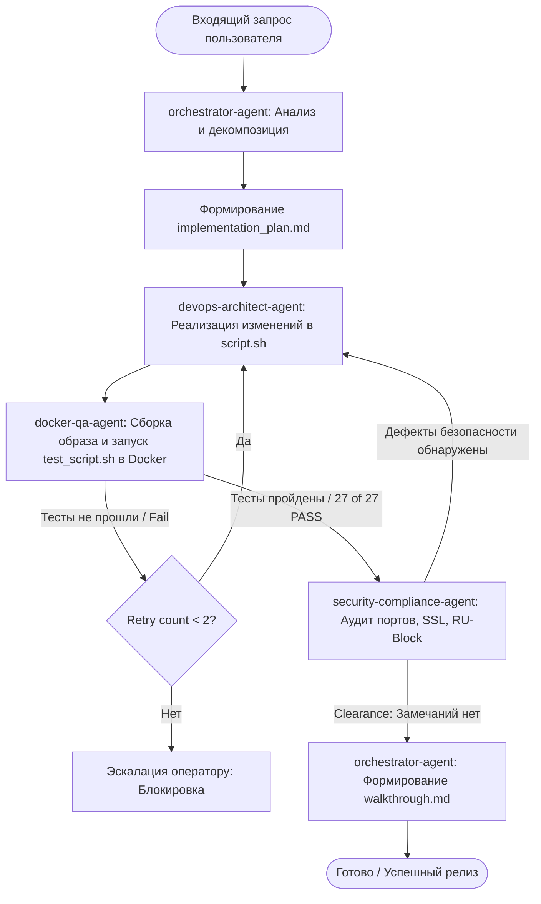

# AGENTS.md — Multi-Agent Infrastructure & Governance Specification

## 1. System Overview

### 1.1 Purpose
Настоящая спецификация определяет архитектуру, зоны ответственности, протоколы взаимодействия и политики безопасности мультиагентной системы для разработки, тестирования и сопровождения инфраструктурного комплекса `vpn_script` (автоматизация развертывания панели 3X-UI, реверс-прокси Nginx со связкой Stream SNI-preread, ядра Xray-core, управления SSL-сертификатами Let's Encrypt, механизма RU-Block и нодовых конфигураций).

### 1.2 System Scope & Operational Environment
- **Целевые операционные системы:** Ubuntu 22.04 LTS, Ubuntu 24.04 LTS, Debian 12 (Bookworm).
- **Ключевые компоненты инфраструктуры:**
  - `script.sh` — монолитный bash-скрипт развертывания и администрирования.
  - `Dockerfile.test` — изолированное контейнеризированное окружение для верификации скрипта и валидации конфигураций.
  - `test_script.sh` — модульный сьют интеграционных и регрессионных тестов (27+ тестовых сценариев).
  - Стек сервисов: `nginx` (модуль `ngx_stream_module`), `3x-ui` (Go-панель + SQLite3), `xray-core` (v26.6.x+), `certbot`, `systemd`.
- **Базовый инвариант исполнения:** Любое тестирование, воспроизведение сценариев и верификация кода проводятся строго внутри Docker-контейнеров. Запуск непроверенного кода на хостовой машине категорически запрещен.

### 1.3 High-Level Architecture & Agent Collaboration Principles
Архитектура строится на базе детерминированного конечного автомата (State Machine) под управлением координирующего агента (`orchestrator-agent`). Агенты обладают жесткой специализацией:
- **Разделение владения:** Агент, разрабатывающий логику, не верифицирует её в одиночку; агент тестирования не модифицирует продуктовый код; агент безопасности осуществляет независимый аудит инвариантов.
- **Идемпотентность и детерминированность:** Все действия агентов обязаны обеспечивать повторную применимость без деградации состояния системы.
- **Fail-Fast с сохранением состояния:** При обнаружении ошибки выполнение конвейера останавливается, фиксируется контрольная точка и запускается процедура отката.

### 1.4 State Management & Persistence
- **Краткосрочная память (Short-term Context):** Контекст текущей итерации, передаваемый через типизированные структуры Handoff Payload.
- **Долгосрочная память (Long-term Artifacts):**
  - `task.md` — актуальное состояние очереди задач и статус верификации.
  - `implementation_plan.md` — архитектурный план и согласованные технические решения.
  - `walkthrough.md` — сводный журнал внесенных изменений и результатов прогона тестов.
  - Резервные копии баз данных (`/etc/x-ui/x-ui.db.bak`) и снапшоты конфигураций Nginx.

---

## 2. Agent Directory

| Agent Name | Primary Role | Invocation Trigger | Primary Tools & Skills | Boundary / Isolation Zone |
| :--- | :--- | :--- | :--- | :--- |
| `orchestrator-agent` | Маршрутизация, декомпозиция задач, контроль жизненного цикла конвейера | Входящий пользовательский запрос, завершение этапа суб-агентом | `plan-creator`, `codebase-audit-progress`, `prompt-optimizer` | Координационный уровень; прямой запрет на изменение bash-скриптов и прямое исполнение shell-команд |
| `devops-architect-agent` | Разработка bash-сценариев, конфигурирование Nginx, тюнинг ядра, интеграция Xray-core | Декомпозированная подзадача от Orchestrator (реализация фичи/багфикс) | `file_editor`, `view_file`, `grep_search` | Рабочая копия `script.sh`, файлы шаблонов конфигураций; запрет на локальный запуск без контейнеризации |
| `docker-qa-agent` | Контейнеризированное тестирование, синтаксический анализ, верификация регрессий | Сигнал готовности правок от DevOps Architect | `run_command` (Docker-only), `test_script.sh`, `Dockerfile.test` | Docker-окружение (`xui-test`); полный запрет на выполнение тестовых скриптов на хостовой ОС |
| `security-compliance-agent` | Аудит безопасности, валидация сетевых портов, проверка RU-Block, SSL-хуков и целостности БД | Завершение тестов QA-агентом перед финализацией задачи | `grep_search`, `view_file`, `git-repo-inspector` | Режим Read-Only ко всем файлам; анализ утечек портов 0.0.0.0, прав доступа `chmod`, валидация SQL-дампов |

### 2.1 Детализация агентов

#### 2.1.1 Orchestrator Agent (`orchestrator-agent`)
- **Описание:** Главный управляющий агент системы. Принимает высокоуровневые требования, декомпозирует их на шаги, контролирует выполнение инвариантов и передает управление специализированным агентам.
- **Входные данные:** Запрос оператора / пользователя, текущее состояние репозитория, логи предыдущих этапов.
- **Выходные данные:** Утвержденный `implementation_plan.md`, обновленный `task.md`, сформированные задачи Handoff Payload для исполнителей.
- **Negative Constraints & Границы изоляции:**
  - Запрещено напрямую модифицировать исполняемые файлы (`script.sh`, `test_script.sh`).
  - Запрещено выполнять деструктивные shell-команды на хосте (`rm -rf`, перезагрузка сервисов).
  - Запрещено завершать задачу без получения подтверждения прохождения тестов от `docker-qa-agent` и отчета безопасности от `security-compliance-agent`.

#### 2.1.2 DevOps Architect Agent (`devops-architect-agent`)
- **Описание:** Эксперт системного администрирования Linux, Bash-скриптинга и сетевых протоколов (VLESS, Reality, gRPC, WebSocket, Stream SNI preread). Отвечает за чистоту кода, переносимость и соответствие лучшим практикам shell-программирования.
- **Входные данные:** Спецификация задачи от Orchestrator, текущий код [`script.sh`](file:///home/kex1tu/Рабочий%20стол/vpn_script/script.sh), диагностические логи сборки/тестирования.
- **Выходные данные:** Измененные исходные файлы с комментариями причин («Why, not What»), обновленные шаблоны генерации конфигураций Nginx/Xray.
- **Negative Constraints & Границы изоляции:**
  - Запрещено хардкодить незащищенные сетевые параметры (например, bind `0.0.0.0` для закрытых внутренних портов панели).
  - Запрещено применять неидемпотентные директивы (симлинки без `-f`, добавление строк в конфиги без проверки дубликатов).
  - Запрещено выполнять скрипт на хостовой операционной системе. Доступен только статический анализ и редактирование файлов.

#### 2.1.3 Docker QA Agent (`docker-qa-agent`)
- **Описание:** Инженер автоматизированного тестирования. Отвечает за воспроизводимость, сборку тестового Docker-образа и прогон набора из 27+ верификационных тестов.
- **Входные данные:** Артефакты исходного кода [`script.sh`](file:///home/kex1tu/Рабочий%20стол/vpn_script/script.sh), [`Dockerfile.test`](file:///home/kex1tu/Рабочий%20стол/vpn_script/Dockerfile.test), [`test_script.sh`](file:///home/kex1tu/Рабочий%20стол/vpn_script/test_script.sh).
- **Выходные данные:** Структурированный отчет о тестировании (список сценариев, PASS/FAIL, дампы ошибок `nginx -t`, `bash -n`, коды возврата).
- **Negative Constraints & Границы изоляции:**
  - Запрещено запускать тесты вне контейнера Docker (директива: «ДЛЯ ТЕСТОВ ИСПОЛЬЗУЙ ДОКЕР И ВСЁ ЗАПУСКАЙ В ДОКЕРЕ»).
  - Запрещено отключать флаги строгой проверки (`set -e` внутри отдельных тестов, игнорирование ненулевых exit-кодов).
  - Запрещено вносить правки в продуктовый [`script.sh`](file:///home/kex1tu/Рабочий%20стол/vpn_script/script.sh) (правки допустимы только в `test_script.sh` и `Dockerfile.test` при обновлении тестового контракта).

#### 2.1.4 Security & Compliance Agent (`security-compliance-agent`)
- **Описание:** Аудитор безопасности инфраструктуры. Контролирует отсутствие утечек портов, валидирует изоляцию нод, механизмы шифрования, хуки автопродления сертификатов и сохранность базы данных пользователей.
- **Входные данные:** Измененный скрипт, артефакты конфигураций Nginx, правила маршрутизации Xray.
- **Выходные данные:** Аудиторское заключение (Security Clearance / Rejection Report) с детальным анализом векторов атак и защитных механизмов.
- **Negative Constraints & Границы изоляции:**
  - Запрещено давать подтверждение (Clearance), если внутренний порт 3X-UI доступен из внешней сети без проксирования через Nginx.
  - Запрещено одобрять генерацию хуков `certbot` без прав исполнения (`chmod +x`) или без команды перезагрузки веб-сервера.
  - Работает строго в режиме Read-Only. Запрещено самостоятельно вносить изменения в проверяемый код.

---

## 3. Orchestration & Workflows

### 3.1 Universal Handoff Payload Schema
Взаимодействие между всеми агентами осуществляется через стандартизированный JSON-контракт. Каждый этап регистрируется с уникальным идентификатором сквозной трассировки (`trace_id`).

```json
{
  "$schema": "https://json-schema.org/draft/2020-12/schema",
  "title": "AgentHandoffPayload",
  "type": "object",
  "required": [
    "trace_id",
    "timestamp",
    "source_agent",
    "target_agent",
    "intent",
    "status",
    "retry_count",
    "payload"
  ],
  "properties": {
    "trace_id": {
      "type": "string",
      "format": "uuid",
      "description": "Сквозной уникальный идентификатор сквозной сессии выполнения"
    },
    "timestamp": {
      "type": "string",
      "format": "date-time",
      "description": "Время передачи контекста в формате ISO 8601"
    },
    "source_agent": {
      "type": "string",
      "enum": ["orchestrator-agent", "devops-architect-agent", "docker-qa-agent", "security-compliance-agent"]
    },
    "target_agent": {
      "type": "string",
      "enum": ["orchestrator-agent", "devops-architect-agent", "docker-qa-agent", "security-compliance-agent"]
    },
    "intent": {
      "type": "string",
      "enum": [
        "EXECUTE_TASK",
        "RUN_VERIFICATION",
        "SECURITY_AUDIT",
        "ESCALATE_ERROR",
        "FINALIZE_RELEASE"
      ]
    },
    "status": {
      "type": "string",
      "enum": ["PENDING", "IN_PROGRESS", "SUCCESS", "FAILED", "BLOCKED"]
    },
    "retry_count": {
      "type": "integer",
      "minimum": 0,
      "maximum": 2,
      "description": "Текущее количество попыток автоматического исправления дефекта"
    },
    "payload": {
      "type": "object",
      "properties": {
        "task_id": { "type": "string" },
        "description": { "type": "string" },
        "target_files": {
          "type": "array",
          "items": { "type": "string" }
        },
        "test_results": {
          "type": "object",
          "properties": {
            "total": { "type": "integer" },
            "passed": { "type": "integer" },
            "failed": { "type": "integer" },
            "failure_details": { "type": "string" }
          }
        },
        "audit_findings": {
          "type": "array",
          "items": { "type": "string" }
        }
      },
      "required": ["task_id", "target_files"]
    }
  }
}
```

### 3.2 Canonical Pipelines

#### 3.2.1 Основной конвейер разработки и верификации (Feature & Fix Pipeline)


1. **Фаза планирования:** `orchestrator-agent` анализирует ТЗ, фиксирует список задач в `task.md` и генерирует `implementation_plan.md`.
2. **Фаза модификации:** `devops-architect-agent` выполняет точечные правки в [`script.sh`](file:///home/kex1tu/Рабочий%20стол/vpn_script/script.sh), соблюдая принципы идемпотентности и чистоты shell-скрипта.
3. **Фаза контейнерного тестирования:** `docker-qa-agent` запускает `docker build` и `docker run --rm xui-test`, проверяя все сценарии. При ошибках управление возвращается разработчику (максимум 2 цикла повтора).
4. **Фаза аудита защищенности:** `security-compliance-agent` проверяет отсутствие утечек закрытых портов, корректность прав `chmod +x` на хуках и неизменность резервных копий.
5. **Фаза сдачи и документации:** `orchestrator-agent` формирует финальный `walkthrough.md` и рапортует пользователю.

#### 3.2.2 Резервное копирование и аварийный откат (Disaster Recovery Pipeline)
При любых операциях изменения конфигурации базы данных SQLite3 3X-UI или глобального сетевого стека:
1. Создание снимка: `/etc/x-ui/x-ui.db.bak_$(date +%s)` перед началом миграций.
2. Проверка целостности дампа: `sqlite3 <db> "PRAGMA integrity_check;"`.
3. Точка восстановления: При получении ошибки `FAILED` от `docker-qa-agent` или фатального сбоя скрипта выполняется автоматический откат из бэкапа и перезапуск сервиса `systemctl restart x-ui`.

### 3.3 Регламент работы с памятью и контекстом
- **Контекст сессии:** Включает только метаданные текущей задачи, открытые файлы и активный шаг.
- **Синхронизация прогресса:** Каждый агент обязан обновлять соответствующий статус в `task.md` непосредственно перед передачей управления (`PENDING` → `IN_PROGRESS` → `DONE`).
- **Сброс контекста:** При переходе между несвязанными крупными задачами накопленные сырые логи отсекаются, а выжимка фиксируется в `walkthrough.md`.

---

## 4. Capabilities & Tool Usage

### 4.1 Матрица авторизации инструментов

| Инструмент / Команда | `orchestrator-agent` | `devops-architect-agent` | `docker-qa-agent` | `security-compliance-agent` |
| :--- | :---: | :---: | :---: | :---: |
| Просмотр файлов (`view_file`, `grep_search`) | ✅ Разрешено | ✅ Разрешено | ✅ Разрешено | ✅ Разрешено |
| Редактирование продуктового кода (`script.sh`) | ❌ Запрещено | ✅ Разрешено | ❌ Запрещено | ❌ Запрещено |
| Редактирование тестов (`test_script.sh`, `Dockerfile.test`) | ❌ Запрещено | ❌ Запрещено | ✅ Разрешено | ❌ Запрещено |
| Запуск Docker (`docker build`, `docker run`) | ❌ Запрещено | ❌ Запрещено | ✅ Разрешено | ❌ Запрещено |
| Прямое выполнение команд на хосте (`run_command` без Docker) | ❌ Запрещено | ❌ Запрещено | ❌ Запрещено | ❌ Запрещено |
| Управление артефактами (`implementation_plan.md`, `walkthrough.md`) | ✅ Разрешено | ❌ Запрещено | ❌ Запрещено | ❌ Запрещено |

### 4.2 Спецификация песочницы (Docker Execution Sandbox)
Все динамические тесты выполняются исключительно внутри контейнеров Docker:
- Образ: сборка на базе `ubuntu:22.04` (с предустановленными пакетами `nginx`, `certbot`, `sqlite3`, `curl`, `iptables`, `systemd-sysv`).
- Сетевая изоляция: Контейнеры запускаются с дефолтным bridge-драйвером, без передачи прав `--privileged` и без прямого доступа к хостовой сети `--net=host` (если это прямо не оговорено в тесте эмуляции локального bind).
- Очистка мусора: Обязательное использование флага `--rm` для исключения утечек дискового пространства после завершения прогона тестов.

### 4.3 Каталог подключаемых навыков (Skills Integration)
- `/home/kex1tu/.gemini/config/skills/plan-creator`: Формирование плана реализации до внесения изменений.
- `/home/kex1tu/.gemini/config/skills/test-runner`: Методология структурирования и анализа вывода тестов.
- `/home/kex1tu/.gemini/config/skills/ci-log-triage`: Анализ упавших тестов и выявление первопричины.
- `/home/kex1tu/.gemini/config/skills/git-repo-inspector`: Контроль состояния рабочей директории.
- `/home/kex1tu/.gemini/config/skills/git-commit-workflow`: Подготовка коммитов в соответствии со стандартом Conventional Commits.

---

## 5. Safety & Guardrails

### 5.1 Negative Constraints (Жесткие запреты)
1. **Категорический запрет на тестирование на хостовой ОС:** Ни при каких обстоятельствах не запускать `bash script.sh` напрямую на хосте разработчика. Тестирование производится **строго в Docker-контейнере** (`Dockerfile.test`).
2. **Запрет на утечку внутренних портов:** Запрещено настраивать конфигурацию Nginx или 3X-UI с открытием веб-панели управления на `0.0.0.0:[порт]` в открытом виде. Доступ к админке должен быть защищен внутренним `127.0.0.1` или идти через проксирующий виртуальный хост с TLS.
3. **Запрет на деструктивные операции без бэкапа:** Любые действия по сбросу, очистке или миграции базы данных SQLite3 3X-UI запрещены без предварительного создания целостного бэкапа файла БД.
4. **Запрет на silent failure (подавление ошибок):** Запрещено подавлять ошибки критических системных утилит через конструкцию `cmd || true`, если неуспех команды может нарушить целостность развертывания (за исключением заведомо ожидаемых пустых поисковых выводов `grep`).
5. **Запрет на перезапись пользовательских сертификатов:** Запрещено принудительно удалять или инвалидировать существующие production-сертификаты в `/etc/letsencrypt/` без явного подтверждения оператора.

### 5.2 Протокол защиты от галлюцинаций (Anti-Hallucination Protocol)
- **Верификация через синтаксический чекер:** Любой сгенерированный или отредактированный bash-код должен быть валидирован через `bash -n` перед отправкой в Docker QA.
- **Валидация конфигураций сервисов:** Конфигурационные файлы Nginx обязаны проверяться утилитой `nginx -t` внутри контейнера до перезапуска демона.
- **Проверка факта наличия файлов:** Запрещено делать предположения о структуре директорий — перед обращением к путям (`/etc/nginx/conf.d/`, `/usr/local/x-ui/bin/`) агент обязан проверить их наличие через `view_file` или `run_command` с `test -e`.

### 5.3 Регламент обработки отказов и эскалации (Fail-Fast & Escalation Path)
```text
Ошибка на этапе тестирования / аудита
│
├── Попытка 1: Анализ лога ошибки -> devops-architect-agent устраняет причину -> Повторный тест в Docker
│
├── Попытка 2: Анализ регрессии -> devops-architect-agent вносит минимальный фикс -> Повторный тест в Docker
│
└── Ошибка повторяется (Retry Limit = 2 исчерпан):
    ├── 1. Немедленная остановка конвейера (State: BLOCKED).
    ├── 2. Откат рабочей копии до стабильного состояния.
    ├── 3. Фиксация точного лога падения, diff изменений и контекста в implementation_plan.md.
    └── 4. Эскалация оператору (человеку) с запросом инструкций.
```
