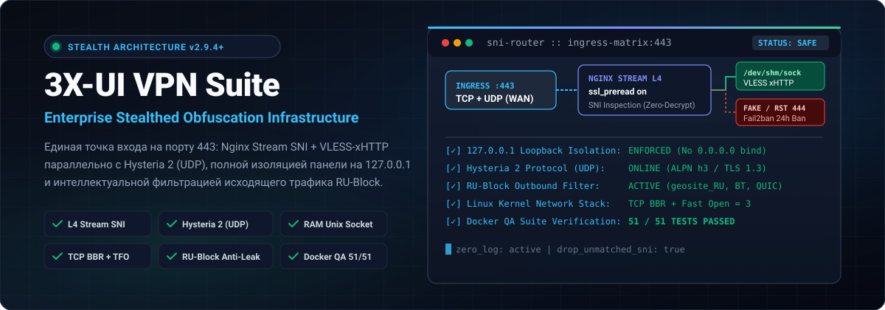
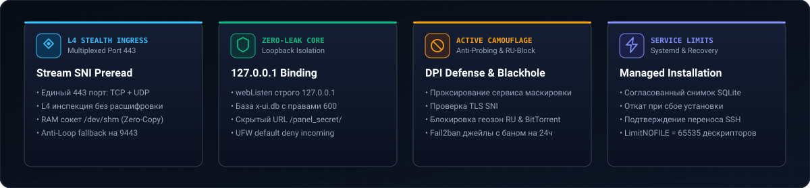
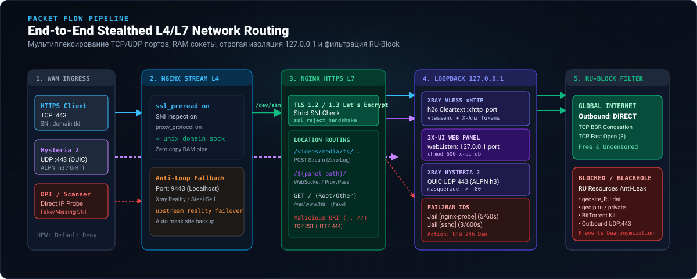
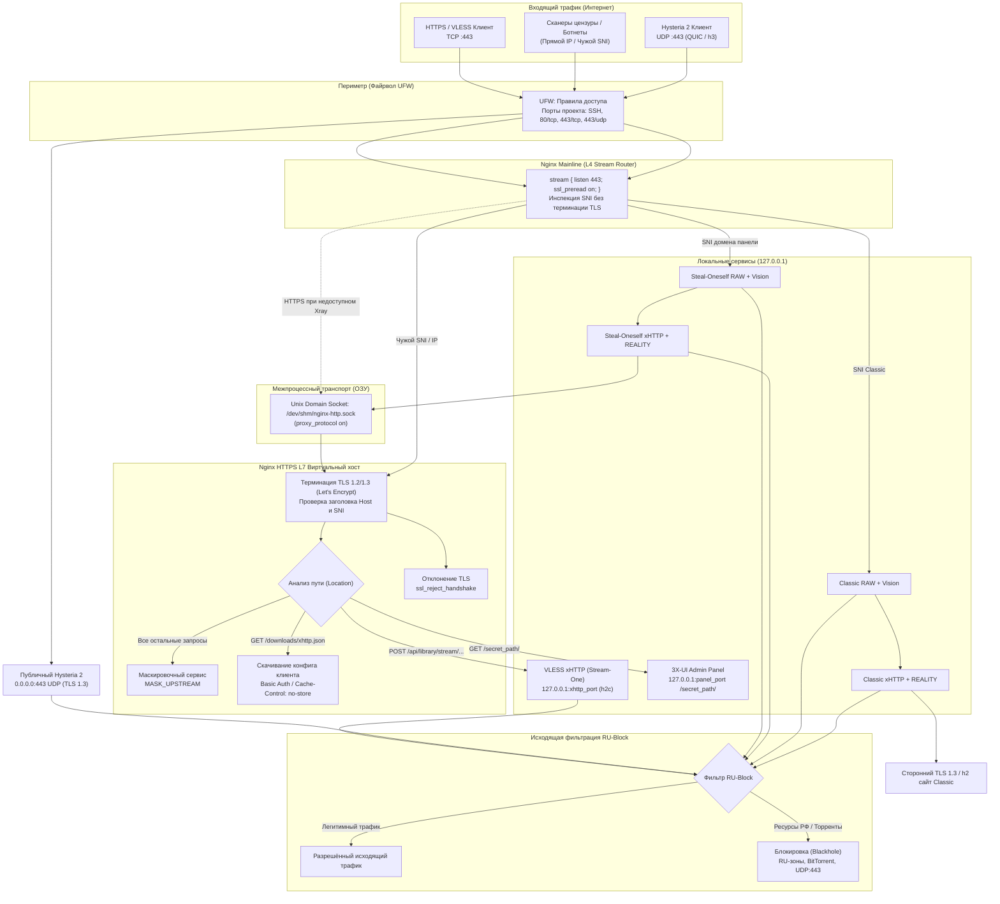

<p align="center">
  
</p>

<p align="center">
  <a href="https://ubuntu.com/"></a>
  <a href="https://nginx.org/"></a>
  <a href="https://github.com/XTLS/Xray-core"></a>
  <a href="https://github.com/MHSanaei/3x-ui"></a>
  
  
  
  
</p>

<p align="center">
  <strong>Автоматизированный комплекс развертывания и защиты серверной инфраструктуры обхода интернет-цензуры.</strong><br>
  Единый порт 443 (TCP + UDP), L4 Stream SNI-маршрутизация, оперативная память /dev/shm, изоляция на 127.0.0.1, RU-Block и управляемые DNS-профили.
</p>

---

<p align="center">
  
</p>

---

## 📑 Содержание

- [1. Быстрый старт (Установка)](#1-быстрый-старт-установка)
  - [1.1 Подготовка](#11-подготовка)
  - [1.2 Установка](#12-установка)
  - [1.3 Обновление старого узла](#13-обновление-старого-узла)
  - [1.4 Справочник аргументов](#14-справочник-аргументов)
- [2. Архитектура и сетевая схема](#2-архитектура-и-сетевая-схема)
  - [2.1 Принципы эшелонированной защиты](#21-принципы-эшелонированной-защиты)
  - [2.2 Визуальная схема прохождения пакетов (L4/L7)](#22-визуальная-схема-прохождения-пакетов-l4l7)
  - [2.3 Матрица сетевых сокетов и портов](#23-матрица-сетевых-сокетов-и-портов)
- [3. Стек протоколов и инбаунды](#3-стек-протоколов-и-инбаунды)
  - [3.1 VLESS + xHTTP (Stream-One)](#31-vless--xhttp-stream-one)
  - [3.2 Hysteria 2 (QUIC / UDP)](#32-hysteria-2-quic--udp)
  - [3.3 REALITY Steal-Oneself и Classic](#33-reality-steal-oneself-и-classic)
  - [3.4 Клиентские ссылки](#34-клиентские-ссылки)
- [4. Эшелонированная безопасность и Hardening](#4-эшелонированная-безопасность-и-hardening)
  - [4.1 Изоляция панели на 127.0.0.1](#41-изоляция-панели-на-127001)
  - [4.2 RU-Block и DNS](#42-ru-block-и-dns)
  - [4.3 Перенос SSH](#43-перенос-ssh)
  - [4.4 Защита SSH через Fail2ban](#44-защита-ssh-через-fail2ban)
  - [4.5 Маскировка и TLS](#45-маскировка-и-tls)
- [5. Системные лимиты](#5-системные-лимиты)
- [6. Системные требования](#6-системные-требования)
- [7. Контейнеризированное тестирование в Docker](#7-контейнеризированное-тестирование-в-docker)
  - [7.1 Автоматизированные проверки](#71-автоматизированные-проверки)
  - [7.2 Интерактивная веб-песочница в браузере](#72-интерактивная-веб-песочница-в-браузере)
- [8. Эксплуатация, администрирование и бэкапы](#8-эксплуатация-администрирование-и-бэкапы)
  - [8.1 Управление службами и просмотр логов](#81-управление-службами-и-просмотр-логов)
  - [8.2 Скрипт автоматического аудита узла (audit.sh)](#82-скрипт-автоматического-аудита-узла-auditsh)
  - [8.3 Служебные файлы и транзакционное восстановление](#83-служебные-файлы-и-транзакционное-восстановление)
- [9. Удаление ресурсов проекта](#9-удаление-ресурсов-проекта)
- [10. Порядок разработки и проверки](#10-порядок-разработки-и-проверки)

---

## 1. Быстрый старт (Установка)

### 1.1 Подготовка

Установка выполняется на чистый сервер с Ubuntu 22.04/24.04 или Debian 12 (amd64) с правами суперпользователя (`root`).

1. **DNS-записи:** Направьте A-запись (и AAAA-запись при наличии IPv6) вашего поддомена на публичный IP-адрес сервера.
2. **Сервис маскировки:** Запустите локальный HTTP(S)-сервис прикрытия, который будет отдавать нейтральную веб-страницу для сторонних сканеров (например, на `127.0.0.1:8000`).
3. **Предварительные зависимости:** Для запуска требуются `bash`, `python3`, `iproute2` и `util-linux`. При обновлении существующей базы данных потребуется `sqlite3`.

Перед реальным развёртыванием рекомендуется запустить валидацию в режиме dry-run:
```bash
git clone https://github.com/kex1tu/vpn_script.git
cd vpn_script
sudo ./script.sh -subdomain vpn.example.com -mask_port 8000 -dry_run y
```

Dry-run проверяет DNS, параметры origin и конфликты портов. Для цели Classic проверяется синтаксис имени. Доступность сервиса прикрытия и сетевые требования к цели Classic проверяются при развёртывании.

### 1.2 Установка

**Базовая установка:**
```bash
sudo ./script.sh -subdomain vpn.example.com -mask_port 8000
```

**Полная производственная установка (со всеми опциями):**
```bash
sudo ./script.sh \
  -subdomain vpn.example.com \
  -mask_port 8000 \
  -reality_target www.microsoft.com \
  -xhttp_config_path /var/lib/vpn-script/xhttp.json \
  -xhttp_download_path /downloads/xhttp.json \
  -block_ru y \
  -dns_provider none
```

Установщик развёртывает модули в систему и регистрирует бинарник `/usr/local/sbin/vpn-script`, поэтому в дальнейшем вызывать утилиту можно напрямую: `sudo vpn-script ...`.

После завершения скрипт генерирует:
- **Файл учётных данных и ссылок:** `/var/lib/vpn-script/credentials` (права `0600`). Доступен только `root` и содержит:
  - Секретный URL панели управления (например, `https://vpn.example.com/aB3x9K.../`);
  - Логин и пароль администратора панели (при обновлении существующие нестандартные данные сохраняются);
  - Отдельный пароль для защищённого скачивания клиентского конфига (если включён `-xhttp_download_path`);
  - 6 готовых клиентских ссылок (`vless://` и `hysteria2://`).
- **Конфигурация клиента Xray:** сохраняется в `/var/lib/vpn-script/xhttp.json` (права `0600`). При запуске локального клиента Xray с этим конфигом открывается SOCKS5-прокси на `127.0.0.1:10808`.
- **Защищённое HTTPS-скачивание конфигурации:** при указании `-xhttp_download_path` файл можно безопасно скачать на рабочую станцию:
  ```bash
  umask 077
  curl --fail --user xhttp --output "$HOME/vpn-xhttp.json" \
    https://vpn.example.com/downloads/xhttp.json
  ```
  *(пароль берётся из `/var/lib/vpn-script/credentials`)*.

В процессе установки автоматически конфигурируются сразу **шесть независимых инбаундов**:
1. `VLESS xHTTP (TLS)` — высокоскоростной стриминг через терминирование TLS в Nginx и cleartext h2c;
2. `Hysteria 2 (UDP/QUIC)` — нативный UDP 443 с TLS 1.3 и маскировкой неавторизованных HTTP/3 запросов;
3. `REALITY Steal-Oneself RAW` — TCP 443 c `xtls-rprx-vision` и маскировкой под собственный домен панели;
4. `REALITY Steal-Oneself xHTTP` — xHTTP `stream-one` с маскировкой под домен панели;
5. `REALITY Classic RAW` — TCP 443 c `xtls-rprx-vision` и маскировкой под сторонний сайт (по умолчанию `www.microsoft.com`);
6. `REALITY Classic xHTTP` — xHTTP `stream-one` с маскировкой под сторонний сайт.

Цель маскировки Classic валидируется перед применением: проверяются внешние адреса, валидность сертификата, поддержка TLS 1.3 и протокола HTTP/2.

### 1.3 Обновление старого узла

При наличии установленного ранее 3X-UI или предыдущих ревизий скрипта выполните аудит без изменений:
```bash
sudo ./script.sh -subdomain vpn.example.com -mask_port 8000 -dry_run y
```
Dry-run выводит распознанные ресурсы и сообщает о конфликтах. Если проверка прошла и в выводе есть строка `Legacy adoption token:`, запустите команды ниже и введите значение из этой строки по запросу `read`.

```bash
read -r -p 'Legacy adoption token: ' adopt_token
sudo ./script.sh \
  -subdomain vpn.example.com \
  -mask_port 8000 \
  -adopt_legacy y \
  -adopt_token "${adopt_token:?Введите токен из dry-run}"
```
При этом существующие клиенты, счётчики трафика, нестандартные логины/пароли и сертификаты полностью сохраняются.

### 1.4 Справочник аргументов

| Аргумент | Допустимые значения | По умолчанию | Назначение |
| :--- | :--- | :--- | :--- |
| `-subdomain` | FQDN (доменное имя) | — | Публичное доменное имя для выпуска TLS и L4 SNI-маршрутизации (обязательно при чистой установке) |
| `-auto_domain` | `y` / `n` | `n` | Использовать автоматический домен вида `<IP>.cdn-one.org` при отсутствии собственного |
| `-mask_upstream` | HTTP(S)-адрес без пути | Сохранённый origin или `http://127.0.0.1` при заданном `-mask_port` | Адрес сервиса прикрытия. На чистой установке укажите этот флаг или `-mask_port` |
| `-mask_port` | `1`–`65535` | Порт origin или стандартный порт схемы (HTTP 80, HTTPS 443) | Переопределяет порт заданного или сохранённого origin. Порт `8000` используется в примерах с локальным сервисом |
| `-reality_target` | FQDN стороннего сайта | `www.microsoft.com` | Внешняя маскировка Classic REALITY; строго проверяется на TLS 1.3 и h2 |
| `-xhttp_config_path` | Абсолютный путь к `.json` | `/var/lib/vpn-script/xhttp.json` | Путь сохранения готового JSON-файла клиента Xray (права `0600`) |
| `-xhttp_download_path` | URL-путь или `none` | `none` | Опциональный HTTPS-маршрут для защищённого скачивания конфига клиента с Basic Auth |
| `-block_ru` | `y` / `n` | `y` | Включить RU-Block для RU-доменов, RU-IP, BitTorrent и исходящего UDP/443. Запрет приватных и локальных назначений действует в обоих режимах |
| `-dns_provider` | `none`, `geohide`, `xboxdns`, `comss` | `none` | Выбор DoH DNS-профиля для обхода региональных блокировок с отказоустойчивым fallback |
| `-ssh_port` | `22`–`65535` | — | Запросить безопасный двухэтапный перенос порта SSH с 10-минутным таймером автоотката |
| `-ssh_confirm` | `y` | — | Подтвердить успешный вход на новый SSH-порт из новой сессии (деактивирует таймер отката) |
| `-ssh_rollback` | `y` / `n` | `n` | Служебный запуск отката. Пока миграция ожидает подтверждения и срок ещё действует, команда завершится с кодом `0`, сохранив конфигурацию SSH |
| `-public_ip4` | IPv4-адрес | Автоопределение | Явно указать публичный IPv4-адрес сервера для валидации DNS |
| `-public_ip6` | IPv6-адрес | Автоопределение | Явно указать публичный IPv6-адрес сервера для валидации DNS |
| `-install` | `y` / `n` | `y` | Установка и обновление системных пакетов и зависимостей через APT |
| `-dry_run` | `y` / `n` | `n` | Предварительные проверки без развёртывания. При наличии распознанных старых ресурсов выводит `adopt_token` |
| `-adopt_legacy` | `y` / `n` | `n` | Разрешить принятие ранее созданных ресурсов и базы данных |
| `-adopt_token` | Хеш-строка | `""` | Токен подтверждения принятия ресурсов, сгенерированный в `-dry_run y` |
| `-uninstall` | `y` / `n` | `n` | Удаление зарегистрированных ресурсов проекта с сохранением баз и сертификатов |

---

## 2. Архитектура и сетевая схема

### 2.1 Принципы эшелонированной защиты

Комплекс исключает выставление сервисов панели и инбаундов напрямую в интернет:

1. **Единый порт 443 (TCP + UDP):** 
   - `443/TCP` обслуживается Nginx Stream (`ssl_preread on`) без расшифровки трафика.
   - `443/UDP` напрямую слушает инбаунд **Hysteria 2** с нативным TLS 1.3 и ALPN `h3`.
2. **Внутренний Unix-сокет:**
   - SNI домена панели ведёт в цепочку Steal-Oneself RAW → xHTTP → `/dev/shm/nginx-http.sock`; SNI Classic — в Classic RAW → xHTTP → сторонний HTTPS:443. У каждого REALITY-входа собственные ключи и short ID; подходящие соединения обслуживаются на своём звене, остальные передаются дальше.
   - Между локальными звеньями передаётся PROXY protocol, перед внешним сайтом он отключён. При недоступности Xray Nginx направляет HTTPS домена панели непосредственно на внутренний Unix-сокет.
3. **Изоляция Localhost:**
   - Веб-панель 3X-UI, xHTTP/TLS-backend и все четыре REALITY-входа слушают исключительно `127.0.0.1`.
4. **Проверка SNI:**
   - Nginx отклоняет TLS-рукопожатие без корректного SNI.

---

### 2.2 Визуальная схема прохождения пакетов (L4/L7)

<p align="center">
  
</p>



---

### 2.3 Матрица сетевых сокетов и портов

| Служба | Протокол | Локальный сокет | Публичный порт | Доступ извне | Назначение |
| :--- | :---: | :---: | :---: | :---: | :--- |
| **Nginx Stream** | TCP | `0.0.0.0:443`, `[::]:443` | `443` | Открыт | L4 маршрутизация по SNI на сокет в памяти |
| **Hysteria 2 (Xray)** | UDP | `0.0.0.0:443` | `443` | Открыт | Резервный скоростной QUIC-туннель |
| **Nginx HTTP/2 VHost** | UNIX | `unix:/dev/shm/nginx-http.sock` | — | Закрыт (ОЗУ) | Терминация TLS, маскировка, проксирование маскировочного сайта |
| **Nginx вспомогательный TLS** | TCP | `127.0.0.1:9443` | — | Локально | Совместимый vhost; новые цепочки завершаются на Unix-сокете |
| **Nginx ACME** | TCP | `0.0.0.0:80` | `80` | Открыт | Прохождение проверок Certbot и редирект на HTTPS |
| **3X-UI Web Admin** | TCP | `127.0.0.1:${panel_port}` | — | **Строго закрыт** | Доступ только через Nginx по секретному пути |
| **VLESS xHTTP Inbound** | TCP | `127.0.0.1:${xhttp_port}` | — | **Строго закрыт** | Cleartext h2c бэкенд для VLESS стриминга |
| **REALITY Self RAW/xHTTP, Classic RAW/xHTTP** | TCP | Четыре отдельных `127.0.0.1:port` | Через Nginx `443` | **Прямой доступ закрыт** | Порты и идентификаторы ролей сохраняются в закрытом state-файле |
| **OpenSSH Daemon** | TCP | Адреса и порты из настроек SSH | Действующий SSH-порт | По правилам SSH и firewall | При переносе старый и новый порты доступны до подтверждения или отката |

---

## 3. Стек протоколов и инбаунды

### 3.1 VLESS + xHTTP (Stream-One)

Nginx принимает публичный TCP 443, завершает внешний TLS и проксирует поток HTTP/2 (cleartext h2c) на внутренний loopback-порт Xray (`127.0.0.1:xhttp_port`).
- **Секретные пути и заголовки:** Установщик генерирует уникальный URL-путь и набор заголовков xHTTP, сохраняя их при последующих обновлениях.
- **Активный камуфляж:** Запросы без корректного заголовка или пути Nginx прозрачно перенаправляет на сервис маскировки (`-mask_upstream`).
- **Локальный экспорт конфигурации:** Первый активный клиент автоматически экспортируется в готовый файл `/var/lib/vpn-script/xhttp.json` (права `0600`), готовый для использования с официальным Xray-core CLI.
- **Опциональный HTTPS-маршрут скачивания:** При указании `-xhttp_download_path` маршрут отдаётся только после HTTP Basic-аутентификации с заголовком `Cache-Control: private, no-store`.

### 3.2 Hysteria 2 (QUIC / UDP)

Hysteria 2 слушает публичный UDP на порту 443 и использует полноценный TLS 1.3 с боевым сертификатом домена.
- **Устойчивость к потерям:** Протокол на базе QUIC обеспечивает минимальные задержки и обход замедлений на нестабильных каналах связи.
- **Согласованная маскировка:** Неавторизованные HTTP/3-запросы проксируются на тот же origin сервиса прикрытия (`-mask_upstream` и `-mask_port`).
- **Автоматическое исправление (Auto-heal):** Установщик гарантирует корректную привязку `0.0.0.0` и настройку `externalProxy` в stream settings Hysteria 2.
- **Единый хук обновления TLS:** Продление сертификата через Certbot автоматически синхронизирует и Nginx, и слушатель Hysteria 2.

### 3.3 REALITY Steal-Oneself и Classic

Для каждого типа маскировки создаются два параллельных независимых инбаунда: **RAW + Vision** и **xHTTP stream-one**:
1. **Steal-Oneself (Кража у себя):** В качестве SNI используется собственный домен панели. Не-VPN трафик через внутренний сокет передаётся веб-серверу Nginx, исключая любые сетевые аномалии или несовпадения сертификатов.
2. **Classic REALITY:** В качестве SNI используется внешний популярный веб-сайт (по умолчанию `www.microsoft.com`). Трафик сканеров прозрачно проксируется на реальный сторонний 443-порт. Перед применением модуль `lib/reality.py` проверяет валидность сертификата, TLS 1.3 и ALPN h2 выбранной цели.

**Режимы Vision и QUIC:**
- RAW-инбаунды используют режим потока `flow=xtls-rprx-vision`, блокирующий UDP/443 на стороне клиента, заставляя браузеры использовать TCP.
- Для приложений, требующих нативный QUIC, в клиенте доступен модификатор `flow=xtls-rprx-vision-udp443` (серверная политика RU-Block при этом сохраняет блокировку нежелательного исходящего трафика).

### 3.4 Клиентские ссылки

Все шесть ссылок генерируются при установке и сохраняются в `/var/lib/vpn-script/credentials`:

| Профиль | Протокол | Транспорт / Режим | SNI | Назначение |
| :--- | :--- | :--- | :--- | :--- |
| **xHTTP TLS** | VLESS | xHTTP (`mode=stream-one`, TLS) | Домен панели | Основной скоростной веб-протокол через Nginx |
| **Hysteria 2** | Hysteria 2 | UDP (QUIC / h3, TLS 1.3) | Домен панели | Максимальная скорость на мобильных и нестабильных сетях |
| **Self RAW** | VLESS | TCP (`xtls-rprx-vision`, REALITY) | Домен панели | Классический REALITY с маскировкой под свой сайт |
| **Self xHTTP** | VLESS | xHTTP (`mode=stream-one`, REALITY) | Домен панели | xHTTP REALITY с маскировкой под свой сайт |
| **Classic RAW** | VLESS | TCP (`xtls-rprx-vision`, REALITY) | Внешний сайт | REALITY с маскировкой под сторонний сайт (Microsoft) |
| **Classic xHTTP** | VLESS | xHTTP (`mode=stream-one`, REALITY) | Внешний сайт | xHTTP REALITY с маскировкой под сторонний сайт |

**Поддерживаемые клиентские приложения:**
- **Windows / Linux:** v2rayN, Hiddify, sing-box, Xray CLI;
- **Android:** v2rayNG, Happ, Hiddify, V2Box;
- **iOS / macOS:** Happ, Incy, V2Box, Hiddify, FoXray.

**Использование готового Xray-клиента через CLI:**
```bash
# Запуск официального клиента Xray с экспортированным конфигом:
xray run -c /var/lib/vpn-script/xhttp.json

# Проверка работоспособности через локальный SOCKS5 (порт 10808):
curl --socks5-hostname 127.0.0.1:10808 https://api.ipify.org
```

---

## 4. Эшелонированная безопасность и Hardening

### 4.1 Изоляция панели на 127.0.0.1
Параметр `webListen` в базе SQLite жестко зафиксирован на `127.0.0.1`. Вход в панель управления возможен только через обратный прокси Nginx по случайно сгенерированному секретному пути (например, `https://domain.tld/r8K2p9Lm4Q/`). Файл базы `/etc/x-ui/x-ui.db` защищен правами `chmod 600`.

---

### 4.2 RU-Block и DNS

`-block_ru y` блокирует RU-домены и RU-IP независимыми правилами, а также блокирует BitTorrent и исходящий UDP/443 для управляемых VPN-инбаундов. `-block_ru n` снимает правила RU-Block, которыми управляет проект. Запрет доступа к приватным и локальным адресам действует в обоих режимах.

| DNS-профиль | Назначение |
| :--- | :--- |
| `none` | Обычные резолверы Xray. Значение по умолчанию при чистой установке |
| `geohide` | GeoHide EU через DoH |
| `xboxdns` | XboxDNS через DoH |
| `comss` | Comss.one через DoH |

Профиль применяется к управляемому списку доменов. При отказе провайдера Xray пробует обычные резолверы с теми же сетевыми блокировками. При обновлении без флага сохраняется предыдущий профиль.

### 4.3 Перенос SSH

Укажите `-ssh_port 60022`, чтобы открыть новый порт с сохранением текущего доступа. После сообщения о переносе войдите на новый порт. Подтвердите перенос из новой сессии в течение десяти минут.

```bash
ssh -p 60022 user@vpn.example.com
sudo --preserve-env=SSH_CONNECTION /usr/local/sbin/vpn-script -ssh_confirm y
```

Если подтверждение не поступило, таймер возвращает прежнюю конфигурацию. Правила UFW, добавленные оператором, сохраняются.

### 4.4 Защита SSH через Fail2ban

Джейл `sshd` читает журнал systemd. После трёх неудачных попыток за десять минут он блокирует адрес на сутки через `iptables-allports`. Блокировка действует и при выключенном UFW.

### 4.5 Маскировка и TLS

Nginx отклоняет TLS-рукопожатие с чужим или отсутствующим SNI. Обычные запросы с корректным SNI обслуживает origin из `-mask_upstream` и `-mask_port`. Этот же origin используется Hysteria 2. Certbot использует управляемый webroot, а хук продления обновляет Nginx и 3X-UI.

---

## 5. Системные лимиты

Для Nginx и 3X-UI устанавливаются отдельные drop-in файлы systemd с
`LimitNOFILE=65535`. Параметры глобального сетевого стека выбираются при подготовке ОС. В VLESS используются настройки BBR на уровне сокета Xray.

---

## 6. Системные требования

Проверяемая матрица включает Ubuntu 22.04, Ubuntu 24.04 и Debian 12 с systemd на amd64. ARM64 исключена из текущей приёмки; её полная поддержка не подтверждена. Для публичного узла нужны DNS-записи и входящие `80/tcp`, `443/tcp`, `443/udp` и действующий SSH-порт.

Установщик и Docker используют закреплённые версии из [lib/versions.conf](lib/versions.conf). Функциональный минимум Nginx для проксирования по HTTP/2 — 1.29.4. Минимум безопасности для выбранной ветки указан отдельно в том же файле.

## 7. Контейнеризированное тестирование в Docker

### 7.1 Автоматизированные проверки

Проверки выполняются в Docker без привилегированного режима и сети хоста. Базовый сьют содержит 12 поведенческих проверок ([test_script.sh](test_script.sh)), выполняемых в строгой изоляции без сети (`--network none`):
1. `test_deployment_lock` — защита от параллельных модификаций через `flock` и корректное освобождение блокировки;
2. `test_deployment_rollback` — атомарный откат SQLite через `.backup`, восстановление исходных файлов и симлинков;
3. `test_syntax_and_openssh` — синтаксис Bash/Python-файлов и строгая валидация конфигурации `sshd`;
4. `test_preflight` — обнаружение старых ресурсов и отказ при неверном upstream без модификации системы;
5. `test_xray_routing_and_links` — корректность маршрутов Xray, независимость правил RU-Block, профили DoH DNS и генерация 6 клиентских ссылок;
6. `test_audit_listener_failure` — выявление открытых наружу backend-сокетов, проверка прав и реакция на недоступность `ss`;
7. `test_reality_contract` — аддитивная миграция 4 REALITY-инбаундов с сохранением пользователей, ключей и счётчиков трафика;
8. `test_legacy_resource_recognition` — распознавание jail Fail2ban (`iptables-allports`), drop-in файлов systemd и легаси stream;
9. `test_ssh_socket_listener_check` — корректное определение слушателей при активации через `ssh.socket` в systemd;
10. `test_startup_interrupted_rollback_reporting` — безопасный вывод отчёта и сохранение данных восстановления при прерванной транзакции;
11. `test_xhttp_migration_no_empty_headers` — фильтрация пустых заголовков в `xhttpSettings` при миграции баз данных;
12. `test_credentials_preservation_on_repeat` — сохранение существующих `Username` и `Password` при повторных прогонах.

По умолчанию образ строится на Ubuntu 22.04. Для остальных целевых ОС передайте `--build-arg BASE_IMAGE=ubuntu:24.04` или `--build-arg BASE_IMAGE=debian:12`. Для ARM64 используйте совместимый раннер.

Classic в интеграционной матрице использует отдельную TLS 1.3/h2-цель внутри Docker, тестовые DNS и CA. Проверяются смена сайта, неверный сертификат, TLS 1.2, отсутствие HTTP/2, неверные ключи/short ID/SNI, шесть одновременно работающих ссылок и HTTPS при остановке Xray. Внешняя матрица использует внутреннюю сеть с native IPv6 и проверяет прямую недоступность всех backend-портов по обоим семействам IP. UDP/443 у RAW проверяется отдельным клиентским пробником с `xtls-rprx-vision-udp443`, чтобы клиентский запрет не скрывал серверную политику RU-Block; шесть обычных URI импортируются без изменения.

```bash
docker build -f Dockerfile.test -t xui-test .
docker run --rm --network none xui-test
```

Полная проверка установщика, реальных клиентов, переноса SSH и отказов выполняется отдельной командой. Запускающий скрипт выполняет код проекта внутри Docker. Он создаёт внутреннюю bridge-сеть и выдаёт NET_ADMIN только тестовым контейнерам для назначения контрольных адресов.

```bash
bash tests/docker-matrix.sh
# Настоящий systemd, SSH и таймер после повторного запуска PID 1
bash tests/docker-systemd.sh
# Настоящие службы и клиенты в отдельных контейнерах
bash tests/docker-external.sh
```

Сохранённые журналы перечисляются в выводе команд. Основная матрица использует настоящий sshd с адаптером systemd/UFW. Отдельные `docker-systemd.sh` и `docker-external.sh` запускают настоящий systemd PID 1 в приватном cgroup namespace. Им нужны SYS_ADMIN для перемонтирования собственного cgroup, NET_ADMIN и `apparmor=unconfined`; они не используют `--privileged`, сеть хоста или bind корневого cgroup хоста. Проверка persistent-таймера выполняется после сохранения файловой системы и нового запуска контейнера с чистым `/run`; ядро хоста не перезагружается.

Матрица запускает профили `fresh`, `legacy` и `legacy-default`: чистую установку из проверенного архива, миграцию БД 2.9.4 с нестандартной учёткой и отдельную проверку замены `admin/admin` с сохранением клиентов и счётчиков. После восстановления она повторно проверяет аудит и передачу трафика. Локальный HTTPS DoH-сервис проверяет успешный ответ, отказ TLS, таймаут, выборочную обработку доменов и блокировку фактического IP после DNS. Инъекции отказов включают неверный DNS, чужой порт, повреждённый артефакт, отказ записи SQLite, SIGKILL и сбой отката. SSH-адаптер проверяет ошибки UFW/службы; настоящий systemd — оба режима SSH, сохранение старого входа, отказ подтверждения со старого порта и откат после повторной загрузки. Параметры `QA_IMAGES`, `QA_PROFILES` и `QA_OUTPUT_DIR` ограничивают повторный прогон и задают каталог журналов. `QA_IMAGES` в основной матрице использует записи вида `ubuntu:24.04:noble`, а в отдельных systemd/external-прогонах — коды `jammy`, `noble`, `bookworm`.

Бейдж в начале README отражает результат базового сьюта на трёх ОС. Результаты интеграционных сценариев, коды завершения обёрток, идентификаторы образов и ограничения приведены в [walkthrough.md](walkthrough.md). Статус записан в [task.md](task.md). Для повторного использования подготовленных образов доступен `QA_SKIP_BUILD=y`. Для чистой сборки добавьте `--no-cache` к команде `docker build` выше и повторите её с каждой целевой `BASE_IMAGE`. ARM64 снята с приёмки по решению оператора.

### 7.2 Интерактивная веб-песочница в браузере

```bash
./run_interactive.sh
```

Панель доступна на `https://localhost:8443/panel/` с самоподписанным сертификатом. Порты публикуются на loopback хоста. Случайные логин и пароль выводятся в терминал после проверки HTTP-ответа.

## 8. Эксплуатация, администрирование и бэкапы

### 8.1 Управление службами и просмотр логов

```bash
# Статус управляемых демонов
sudo systemctl status x-ui nginx fail2ban

# Проверка активных слушателей
sudo ss -ltnup | grep -E ':(80|443|22|60022)'

# Просмотр журналов в реальном времени
sudo journalctl -u x-ui -u nginx -n 50 -f
```

### 8.2 Скрипт автоматического аудита узла (audit.sh)

Для регулярной верификации безопасности узла без внесения изменений используйте скрипт `audit.sh`:
```bash
sudo bash audit.sh
```

Скрипт проверяет систему в режиме Read-Only и возвращает `exit code 0` только при отсутствии сбоев:
- **Конфигурация:** Валидирует схему `/var/lib/vpn-script/config.json`;
- **Сетевая изоляция сокетов:** Проверяет внешние точки входа (`80/tcp`, `443/tcp`, `443/udp`), строгую изоляцию внутренних слушателей (панель, xHTTP, 4 инбаунда REALITY) на `127.0.0.1`, права процессов и корректный порт SSH;
- **Файловые права.** Проверяет владельца `root` и права `0700` у `/var/lib/vpn-script` и `/etc/x-ui`, а также владельца `root` и права `0600` у `config.json` и `x-ui.db`.
- **Безопасность БД:** Проверяет фиксацию `webListen = 127.0.0.1`, отключение публичных подписок (`subEnable = false`) и отсутствие стандартных учетных записей `admin/admin`;
- **Маршрутизация и DNS:** Сверяет активные правила Xray-core и DoH с эталонной конфигурацией;
- **Сертификаты:** Проверяет совпадение боевого сертификата в TCP (Nginx) и QUIC (Hysteria 2) через `certificate_probe.py`;
- **DoH-профиль:** Проверяет доступность выбранного провайдера DNS через тестовый wire-запрос без логирования доменов клиентов.

### 8.3 Служебные файлы и транзакционное восстановление

- **`/var/lib/vpn-script/credentials`** (права `0600`) — секретный URL веб-панели, учётные данные администратора, пароль для HTTPS-скачивания и 6 клиентских ссылок.
- **`/var/lib/vpn-script/config.json`** (права `0600`) — реестр активной конфигурации (домен, порты, DNS-профиль, флаг RU-Block, маскировка).
- **`/var/lib/vpn-script/xhttp.json`** (права `0600`) — файл конфигурации для официального Xray CLI.
- **`/usr/local/sbin/vpn-script`** — установленная в систему утилита управления (копия `script.sh`).
- **Транзакционное восстановление.** Перед изменением существующей базы установщик создаёт снимок `/var/lib/vpn-script/transaction.*/x-ui.db` через `.backup` и проверяет его командой `PRAGMA integrity_check;`. Файл `/var/lib/vpn-script/active` содержит имя каталога незавершённой транзакции. При сбое развёртывания и при следующем обычном запуске с незавершённой транзакцией установщик автоматически пытается восстановить ресурсы операции. Если восстановление не удалось, запуск прекращается, а журнал и снимок сохраняются.

## 9. Удаление ресурсов проекта

```bash
sudo ./script.sh -uninstall y -dry_run y
sudo ./script.sh -uninstall y
```

Удаление использует список ресурсов, записанный при установке или принятии старой конфигурации. Пользовательские сайты, БД панели, сертификаты, резервные копии, общие пакеты и действующий SSH сохраняются.

---

## 10. Порядок разработки и проверки

Обязательный регламент — [AGENTS.md](AGENTS.md). Основная модель отвечает за результат целиком; делегирование Gemini через `agy` разрешено по правилам AGENTS.md. Другие субагенты и делегирование через внешние чаты запрещены.

1. Изучить рабочую копию и требования, определить тип задачи и необходимое покрытие. Для нетривиальной задачи записать план в `implementation_plan.md`.
2. Внести правки в необходимые исходники, модули `lib/`, конфигурации и тесты, сохраняя пользовательские изменения.
3. Для кода сначала проверить синтаксис изменённых Shell/Python-файлов и конфигурации служб внутри Docker, затем выполнить базовый сьют и затронутые регрессии из раздела 7.
4. При изменении SSH, БД, восстановления, TLS, сетевой изоляции или приёмке выпуска выполнить полную amd64-матрицу трёх ОС: базовый сьют, `tests/docker-matrix.sh`, `tests/docker-systemd.sh`, `tests/docker-external.sh`.
5. Тем же исполнителем отдельно проверить итоговый diff на безопасность: изоляцию IPv4/IPv6, права, сохранность БД и чужих ресурсов, продление TLS и работу RU-Block по области изменения.
6. Обновить `task.md` и `walkthrough.md`: указать ревизию и незакоммиченные изменения, среду, image ID, команды, exit codes, PASS/FAIL/SKIP и пути к очищенным логам. Исторические результаты не подтверждают текущие файлы.

Для обзора и правок только документации достаточно статической проверки согласованности и ссылок; динамические тесты отмечаются `N/A` с причиной. Для кода должны пройти обязательные проверки по его типу; недоступный стенд или пропуск не считаются PASS.

На хосте разрешены просмотр и редактирование репозитория и проверенные Docker-обёртки. Установщик, аудит, тестируемый код и синтаксические проверки запускаются только внутри контейнеров. Ошибка QA затрагивает только стенд; она не запускает откат рабочей копии или служб production. Inventory серверов не разрешает SSH-доступ без явной задачи пользователя.
