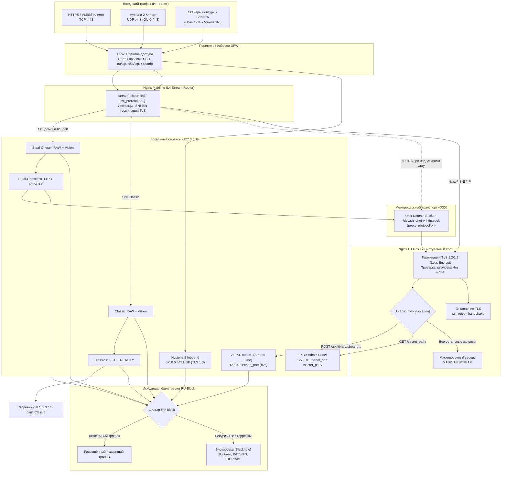

<p align="center">
  
</p>

<p align="center">
  <a href="https://ubuntu.com/"></a>
  <a href="https://nginx.org/"></a>
  <a href="https://github.com/XTLS/Xray-core"></a>
  <a href="https://github.com/MHSanaei/3x-ui"></a>
  
  
  
</p>

<p align="center">
  <strong>Автоматизированный комплекс развертывания и защиты серверной инфраструктуры обхода интернет-цензуры.</strong><br>
  Единый порт 443 (TCP + UDP), L4 Stream SNI-маршрутизация, оперативная память /dev/shm, изоляция на 127.0.0.1, RU-Block и управляемые DNS-профили.
</p>

---

<p align="center">
  
</p>

---

## 📑 Содержание

- [1. Быстрый старт (Установка)](#1-быстрый-старт-установка)
  - [1.1 Подготовка](#11-подготовка)
  - [1.2 Установка](#12-установка)
  - [1.3 Обновление старого узла](#13-обновление-старого-узла)
  - [1.4 Справочник аргументов](#14-справочник-аргументов)
- [2. Архитектура и сетевая схема](#2-архитектура-и-сетевая-схема)
  - [2.1 Принципы эшелонированной защиты](#21-принципы-эшелонированной-защиты)
  - [2.2 Визуальная схема прохождения пакетов (L4/L7)](#22-визуальная-схема-прохождения-пакетов-l4l7)
  - [2.3 Матрица сетевых сокетов и портов](#23-матрица-сетевых-сокетов-и-портов)
- [3. Стек протоколов и инбаунды](#3-стек-протоколов-и-инбаунды)
  - [3.1 VLESS + xHTTP (Stream-One)](#31-vless--xhttp-stream-one)
  - [3.2 Hysteria 2 (QUIC / UDP)](#32-hysteria-2-quic--udp)
  - [3.3 REALITY Steal-Oneself и Classic](#33-reality-steal-oneself-и-classic)
  - [3.4 Клиентские ссылки](#34-клиентские-ссылки)
- [4. Эшелонированная безопасность и Hardening](#4-эшелонированная-безопасность-и-hardening)
  - [4.1 Изоляция панели на 127.0.0.1](#41-изоляция-панели-на-127001)
  - [4.2 RU-Block и DNS](#42-ru-block-и-dns)
  - [4.3 Перенос SSH](#43-перенос-ssh)
  - [4.4 Защита SSH через Fail2ban](#44-защита-ssh-через-fail2ban)
  - [4.5 Маскировка и TLS](#45-маскировка-и-tls)
- [5. Системные лимиты](#5-системные-лимиты)
- [6. Системные требования](#6-системные-требования)
- [7. Контейнеризированное тестирование в Docker](#7-контейнеризированное-тестирование-в-docker)
  - [7.1 Автоматизированные проверки](#71-автоматизированные-проверки)
  - [7.2 Интерактивная веб-песочница в браузере](#72-интерактивная-веб-песочница-в-браузере)
- [8. Эксплуатация, администрирование и бэкапы](#8-эксплуатация-администрирование-и-бэкапы)
- [9. Удаление ресурсов проекта](#9-удаление-ресурсов-проекта)
- [10. Порядок разработки и проверки](#10-порядок-разработки-и-проверки)

---

## 1. Быстрый старт (Установка)

### 1.1 Подготовка

Используйте проверенную копию репозитория с каталогом `lib/`. До запуска подготовьте A-запись домена, укажите корректную AAAA-запись при использовании IPv6 и запустите HTTP(S)-сервис, который будет отдавать маскировочную страницу. В примерах он слушает `127.0.0.1:8000`. Для предварительных проверок нужны `python3`, `iproute2` и `util-linux`. При обновлении также нужен `sqlite3`.

```bash
git clone https://github.com/kex1tu/vpn_script.git
cd vpn_script
sudo ./script.sh -subdomain vpn.example.com -mask_port 8000 -dry_run y
```

### 1.2 Установка

```bash
sudo ./script.sh \
  -subdomain vpn.example.com \
  -mask_port 8000 \
  -xhttp_config_path /root/vpn-xhttp.json \
  -xhttp_download_path /downloads/xhttp.json \
  -block_ru y -dns_provider none
```

Установщик выводит путь к файлу `/var/lib/vpn-script/credentials`. Файл доступен root и содержит выданные учётные данные и клиентские URI. При обновлении действующий нестандартный пароль сохраняется.

Конфиг Xray для xHTTP/TLS сохраняется с правами `0600`. По умолчанию файл находится в `/var/lib/vpn-script/xhttp.json`. Укажите каталог вне webroot. Установщик экспортирует первого активного клиента и обновляет файл при повторном запуске. Xray с этим файлом открывает SOCKS на `127.0.0.1:10808`.

При заданном `-xhttp_download_path` адрес и отдельный пароль для HTTPS-скачивания записываются в `/var/lib/vpn-script/credentials`. На клиентской машине `curl` запросит пароль, а `--output` задаёт местный путь сохранения.

```bash
umask 077
curl --fail --user xhttp --output "$HOME/vpn-xhttp.json" \
  https://vpn.example.com/downloads/xhttp.json
```

Устанавливаются сразу шесть инбаундов: xHTTP/TLS, Hysteria 2, Steal-Oneself RAW/xHTTP и Classic RAW/xHTTP. Параметр `-reality_target www.microsoft.com` задаёт сторонний сайт Classic на 443. Без параметра интерактивный запуск спрашивает сайт, предлагая сохранённое значение или `www.microsoft.com`; без терминала используется это значение автоматически. Перед применением проверяются публичные адреса вне узла, сертификат, TLS 1.3 и HTTP/2. Проверка может использовать доступное семейство IP. В `-dry_run y` для Classic проверяется только имя: сетевой этап явно отмечается SKIP и обязателен при установке.

### 1.3 Обновление старого узла

Сначала повторите команду с `-dry_run y`. Проверьте список обнаруженных ресурсов. Для принятия перечисленных ресурсов повторите установку с `-adopt_legacy y -adopt_token TOKEN`, подставив токен из предварительного прогона. При изменении обнаруженных ресурсов получите новый токен.

### 1.4 Справочник аргументов

| Аргумент | Значения | Назначение |
| :--- | :--- | :--- |
| `-subdomain` | FQDN | Публичное имя для TLS и SNI |
| `-mask_upstream` | HTTP(S)-адрес без пути и учётных данных | Адрес сервиса прикрытия. Сохраняется при обновлении |
| `-mask_port` | `1`–`65535` | Порт уже запущенного сервиса прикрытия. Переопределяет порт в адресе. На чистой установке без адреса используется `http://127.0.0.1` |
| `-xhttp_config_path` | Абсолютный путь к `.json` | Путь экспортируемого файла на сервере. Родительские каталоги должны существовать и быть доступны для записи только root. Сохраняется при обновлении |
| `-xhttp_download_path` | URL-путь, например `/downloads/xhttp.json`, или `none` | HTTPS-скачивание с отдельным паролем. По умолчанию отключено. Путь сохраняется при обновлении, значение `none` отключает скачивание |
| `-reality_target` | FQDN стороннего HTTPS-сайта | Classic SNI/цель на 443; по умолчанию `www.microsoft.com`, при обновлении сохраняется |
| `-public_ip4`, `-public_ip6` | IPv4 или IPv6 | Явно указать публичный адрес узла для DNS-проверки |
| `-install` | `y` / `n` | Установка системных зависимостей. По умолчанию `y` |
| `-ssh_port` | `22`–`65535` | Запросить перенос SSH на указанный порт |
| `-block_ru` | `y` / `n` | Включить управляемый фильтр. По умолчанию `y` |
| `-dns_provider` | `none`, `geohide`, `xboxdns`, `comss` | DNS-профиль для выбранных доменов |
| `-dry_run` | `y` / `n` | Выполнить предварительные проверки и показать кандидатов для принятия |
| `-adopt_legacy`, `-adopt_token` | `y` и токен | Принять ресурсы старой установки после просмотра |
| `-auto_domain` | `y` / `n` | Использовать автоматический домен вида `<IP>.cdn-one.org` |
| `-uninstall` | `y` / `n` | Удалить зарегистрированные ресурсы проекта |

---

## 2. Архитектура и сетевая схема

### 2.1 Принципы эшелонированной защиты

Комплекс исключает выставление сервисов панели и инбаундов напрямую в интернет:

1. **Единый порт 443 (TCP + UDP):** 
   - `443/TCP` обслуживается Nginx Stream (`ssl_preread on`) без расшифровки трафика.
   - `443/UDP` напрямую слушает инбаунд **Hysteria 2** с нативным TLS 1.3 и ALPN `h3`.
2. **Внутренний Unix-сокет:**
   - SNI домена панели ведёт в цепочку Steal-Oneself RAW → xHTTP → `/dev/shm/nginx-http.sock`; SNI Classic — в Classic RAW → xHTTP → сторонний HTTPS:443. У каждого REALITY-входа собственные ключи и short ID; подходящие соединения обслуживаются на своём звене, остальные передаются дальше.
   - Между локальными звеньями передаётся PROXY protocol, перед внешним сайтом он отключён. При недоступности Xray Nginx направляет HTTPS домена панели непосредственно на внутренний Unix-сокет.
3. **Изоляция Localhost:**
   - Веб-панель 3X-UI, xHTTP/TLS-backend и все четыре REALITY-входа слушают исключительно `127.0.0.1`.
4. **Проверка SNI:**
   - Nginx отклоняет TLS-рукопожатие без корректного SNI.

---

### 2.2 Визуальная схема прохождения пакетов (L4/L7)

<p align="center">
  
</p>



---

### 2.3 Матрица сетевых сокетов и портов

| Служба | Протокол | Локальный сокет | Публичный порт | Доступ извне | Назначение |
| :--- | :---: | :---: | :---: | :---: | :--- |
| **Nginx Stream** | TCP | `0.0.0.0:443`, `[::]:443` | `443` | Открыт | L4 маршрутизация по SNI на сокет в памяти |
| **Hysteria 2 (Xray)** | UDP | `0.0.0.0:443` | `443` | Открыт | Резервный скоростной QUIC-туннель |
| **Nginx HTTP/2 VHost** | UNIX | `unix:/dev/shm/nginx-http.sock` | — | Закрыт (ОЗУ) | Терминация TLS, маскировка, проксирование маскировочного сайта |
| **Nginx вспомогательный TLS** | TCP | `127.0.0.1:9443` | — | Локально | Совместимый vhost; новые цепочки завершаются на Unix-сокете |
| **Nginx ACME** | TCP | `0.0.0.0:80` | `80` | Открыт | Прохождение проверок Certbot и редирект на HTTPS |
| **3X-UI Web Admin** | TCP | `127.0.0.1:${panel_port}` | — | **Строго закрыт** | Доступ только через Nginx по секретному пути |
| **VLESS xHTTP Inbound** | TCP | `127.0.0.1:${xhttp_port}` | — | **Строго закрыт** | Cleartext h2c бэкенд для VLESS стриминга |
| **REALITY Self RAW/xHTTP, Classic RAW/xHTTP** | TCP | Четыре отдельных `127.0.0.1:port` | Через Nginx `443` | **Прямой доступ закрыт** | Порты и идентификаторы ролей сохраняются в закрытом state-файле |
| **OpenSSH Daemon** | TCP | `0.0.0.0:${SSH_PORT}` | `60022` *(или `22`)* | Открыт | Удаленное администрирование с защитой Fail2ban |

---

## 3. Стек протоколов и инбаунды

### 3.1 VLESS + xHTTP (Stream-One)

Nginx завершает TLS и передаёт поток HTTP/2 на loopback-порт Xray. Установщик создаёт путь и заголовки xHTTP и сохраняет их при обновлении. При запросе без ожидаемого заголовка Nginx передаёт запрос сервису маскировки.

### 3.2 Hysteria 2 (QUIC / UDP)

Hysteria 2 принимает UDP на порту 443 и использует TLS с сертификатом узла. Неавторизованные HTTP/3-запросы обслуживает заданный сервис маскировки.

### 3.3 REALITY Steal-Oneself и Classic

Для каждого варианта создаются два независимых инбаунда: RAW + Vision и xHTTP `stream-one`. Nginx выбирает локальную цепочку по SNI; разные ключи REALITY направляют клиента к нужному звену. Self использует тот же домен, что и панель, и завершается на собственном HTTPS-входе Nginx. Classic использует выбранный сторонний TLS-сайт. Внутренние соединения не возвращаются на публичный TCP/443.

RAW-ссылки используют `xtls-rprx-vision`. В Xray этот режим блокирует UDP/443 на стороне клиента, чтобы браузер использовал TCP. Для приложений, которым необходим QUIC, клиент может использовать `xtls-rprx-vision-udp443`; серверный запрет UDP/443 при включённом RU-Block при этом сохраняется.

### 3.4 Клиентские ссылки

Импортируйте шесть ссылок с названиями профилей из `/var/lib/vpn-script/credentials`. Все используют публичный адрес сервера и порт 443. Существующий xHTTP/TLS передаёт дополнительные параметры в `extra`; Hysteria 2 использует собственную авторизацию. Четыре новых клиента имеют отдельные UUID, ключи REALITY и short ID. RAW-ссылки содержат `type=tcp` и `flow=xtls-rprx-vision`; новые xHTTP — `type=xhttp`, `mode=stream-one` без Vision. Self использует SNI домена панели, Classic — выбранного сайта.

Ориентир импорта — актуальные стабильные v2rayN, v2rayNG, Happ, Incy, V2Box и Hiddify. Автоматическая проверка закреплённым Xray не заменяет проверку конкретных версий приложений: фактические PASS/SKIP фиксируются в walkthrough. Подписки остаются отключёнными. Обновление с двух инбаундов добавляет четыре новых; повторный запуск сохраняет идентификаторы, клиентов, счётчики, ключи и пути.

---

## 4. Эшелонированная безопасность и Hardening

### 4.1 Изоляция панели на 127.0.0.1
Параметр `webListen` в базе SQLite жестко зафиксирован на `127.0.0.1`. Вход в панель управления возможен только через обратный прокси Nginx по случайно сгенерированному секретному пути (например, `https://domain.tld/r8K2p9Lm4Q/`). Файл базы `/etc/x-ui/x-ui.db` защищен правами `chmod 600`.

---

### 4.2 RU-Block и DNS

`-block_ru y` блокирует RU-домены и RU-IP независимыми правилами, а также блокирует BitTorrent и исходящий UDP/443 для управляемых VPN-инбаундов. `-block_ru n` снимает правила RU-Block, которыми управляет проект. Запрет доступа к приватным и локальным адресам действует в обоих режимах.

| DNS-профиль | Назначение |
| :--- | :--- |
| `none` | Обычные резолверы Xray. Значение по умолчанию при чистой установке |
| `geohide` | GeoHide EU через DoH |
| `xboxdns` | XboxDNS через DoH |
| `comss` | Comss.one через DoH |

Профиль применяется к управляемому списку доменов. При отказе провайдера Xray пробует обычные резолверы с теми же сетевыми блокировками. При обновлении без флага сохраняется предыдущий профиль.

### 4.3 Перенос SSH

Укажите `-ssh_port 60022`, чтобы открыть новый порт с сохранением текущего доступа. После сообщения о переносе войдите на новый порт. Подтвердите перенос из новой сессии в течение десяти минут.

```bash
ssh -p 60022 user@vpn.example.com
sudo --preserve-env=SSH_CONNECTION /usr/local/sbin/vpn-script -ssh_confirm y
```

Если подтверждение не поступило, таймер возвращает прежнюю конфигурацию. Правила UFW, добавленные оператором, сохраняются.

### 4.4 Защита SSH через Fail2ban

Джейл `sshd` читает журнал systemd. После трёх неудачных попыток за десять минут он блокирует адрес на сутки через `iptables-allports`. Блокировка действует и при выключенном UFW.

### 4.5 Маскировка и TLS

Nginx отклоняет TLS-рукопожатие с чужим или отсутствующим SNI. Обычные запросы с корректным SNI обслуживает origin из `-mask_upstream` и `-mask_port`. Этот же origin используется Hysteria 2. Certbot использует управляемый webroot, а хук продления обновляет Nginx и 3X-UI.

---

## 5. Системные лимиты

Для Nginx и 3X-UI устанавливаются отдельные drop-in файлы systemd с
`LimitNOFILE=65535`. Параметры глобального сетевого стека выбираются при подготовке ОС. В VLESS используются настройки BBR на уровне сокета Xray.

---

## 6. Системные требования

Проверяемая матрица включает Ubuntu 22.04, Ubuntu 24.04 и Debian 12 с systemd на amd64. ARM64 исключена из текущей приёмки; её полная поддержка не подтверждена. Для публичного узла нужны DNS-записи и входящие `80/tcp`, `443/tcp`, `443/udp` и действующий SSH-порт.

Установщик и Docker используют закреплённые версии из [lib/versions.conf](lib/versions.conf). Функциональный минимум Nginx для проксирования по HTTP/2 — 1.29.4. Минимум безопасности для выбранной ветки указан отдельно в том же файле.

## 7. Контейнеризированное тестирование в Docker

### 7.1 Автоматизированные проверки

Проверки выполняются в Docker без привилегированного режима и сети хоста. Базовый сьют содержит семь групп поведенческих проверок, включая добавление REALITY с сохранением клиентов и ключей. По умолчанию образ строится на Ubuntu 22.04. Для остальных целевых ОС передайте `--build-arg BASE_IMAGE=ubuntu:24.04` или `--build-arg BASE_IMAGE=debian:12`. Для ARM64 используйте совместимый раннер.

Classic в интеграционной матрице использует отдельную TLS 1.3/h2-цель внутри Docker, тестовые DNS и CA. Проверяются смена сайта, неверный сертификат, TLS 1.2, отсутствие HTTP/2, неверные ключи/short ID/SNI, шесть одновременно работающих ссылок и HTTPS при остановке Xray. Внешняя матрица использует внутреннюю сеть с native IPv6 и проверяет прямую недоступность всех backend-портов по обоим семействам IP. UDP/443 у RAW проверяется отдельным клиентским пробником с `xtls-rprx-vision-udp443`, чтобы клиентский запрет не скрывал серверную политику RU-Block; шесть обычных URI импортируются без изменения.

```bash
docker build -f Dockerfile.test -t xui-test .
docker run --rm --network none xui-test
```

Полная проверка установщика, реальных клиентов, переноса SSH и отказов выполняется отдельной командой. Запускающий скрипт выполняет код проекта внутри Docker. Он создаёт внутреннюю bridge-сеть и выдаёт NET_ADMIN только тестовым контейнерам для назначения контрольных адресов.

```bash
bash tests/docker-matrix.sh
# Настоящий systemd, SSH и таймер после повторного запуска PID 1
bash tests/docker-systemd.sh
# Настоящие службы и клиенты в отдельных контейнерах
bash tests/docker-external.sh
```

Сохранённые журналы перечисляются в выводе команд. Основная матрица использует настоящий sshd с адаптером systemd/UFW. Отдельные `docker-systemd.sh` и `docker-external.sh` запускают настоящий systemd PID 1 в приватном cgroup namespace. Им нужны SYS_ADMIN для перемонтирования собственного cgroup, NET_ADMIN и `apparmor=unconfined`; они не используют `--privileged`, сеть хоста или bind корневого cgroup хоста. Проверка persistent-таймера выполняется после сохранения файловой системы и нового запуска контейнера с чистым `/run`; ядро хоста не перезагружается.

Матрица запускает профили `fresh`, `legacy` и `legacy-default`: чистую установку из проверенного архива, миграцию БД 2.9.4 с нестандартной учёткой и отдельную проверку замены `admin/admin` с сохранением клиентов и счётчиков. После восстановления она повторно проверяет аудит и передачу трафика. Локальный HTTPS DoH-сервис проверяет успешный ответ, отказ TLS, таймаут, выборочную обработку доменов и блокировку фактического IP после DNS. Инъекции отказов включают неверный DNS, чужой порт, повреждённый артефакт, отказ записи SQLite, SIGKILL и сбой отката. SSH-адаптер проверяет ошибки UFW/службы; настоящий systemd — оба режима SSH, сохранение старого входа, отказ подтверждения со старого порта и откат после повторной загрузки. Параметры `QA_IMAGES`, `QA_PROFILES` и `QA_OUTPUT_DIR` ограничивают повторный прогон и задают каталог журналов. `QA_IMAGES` в основной матрице использует записи вида `ubuntu:24.04:noble`, а в отдельных systemd/external-прогонах — коды `jammy`, `noble`, `bookworm`.

Датированные результаты, идентификаторы образов, команды и ограничения текущей приёмки приведены в [walkthrough.md](walkthrough.md); её статус — в [task.md](task.md). ARM64 снята с приёмки по решению оператора. Для повторного использования подготовленных образов доступен `QA_SKIP_BUILD=y`; такой прогон не заменяет проверку сборки образов с нуля. Для чистой сборки добавьте `--no-cache` к команде `docker build` выше и повторите её с каждой целевой `BASE_IMAGE`.

### 7.2 Интерактивная веб-песочница в браузере

```bash
./run_interactive.sh
```

Панель доступна на `https://localhost:8443/panel/` с самоподписанным сертификатом. Порты публикуются на loopback хоста. Случайные логин и пароль выводятся в терминал после проверки HTTP-ответа.

## 8. Эксплуатация, администрирование и бэкапы

```bash
sudo x-ui status
sudo journalctl -u x-ui -u nginx
sudo bash audit.sh
```

Перед изменением существующей SQLite-БД установщик сохраняет согласованный снимок в отдельном каталоге операции внутри `/var/lib/vpn-script/` и проверяет его целостность. При сбое он пытается восстановить исходное состояние. Если восстановление прервано, при следующем запуске установщик обнаруживает незавершённую операцию. Сохраните каталог операции и его снимок, если вывод сообщает об ошибке восстановления.

## 9. Удаление ресурсов проекта

```bash
sudo ./script.sh -uninstall y -dry_run y
sudo ./script.sh -uninstall y
```

Удаление использует список ресурсов, записанный при установке или принятии старой конфигурации. Пользовательские сайты, БД панели, сертификаты, резервные копии, общие пакеты и действующий SSH сохраняются.

---

## 10. Порядок разработки и проверки

Обязательный регламент — [AGENTS.md](AGENTS.md). Основная модель отвечает за результат целиком; делегирование Gemini через `agy` разрешено по правилам AGENTS.md. Другие субагенты и делегирование через внешние чаты запрещены.

1. Изучить рабочую копию и требования, определить тип задачи и необходимое покрытие. Для нетривиальной задачи записать план в `implementation_plan.md`.
2. Внести правки в необходимые исходники, модули `lib/`, конфигурации и тесты, сохраняя пользовательские изменения.
3. Для кода сначала проверить синтаксис изменённых Shell/Python-файлов и конфигурации служб внутри Docker, затем выполнить базовый сьют и затронутые регрессии из раздела 7.
4. При изменении SSH, БД, восстановления, TLS, сетевой изоляции или приёмке выпуска выполнить полную amd64-матрицу трёх ОС: базовый сьют, `tests/docker-matrix.sh`, `tests/docker-systemd.sh`, `tests/docker-external.sh`.
5. Тем же исполнителем отдельно проверить итоговый diff на безопасность: изоляцию IPv4/IPv6, права, сохранность БД и чужих ресурсов, продление TLS и работу RU-Block по области изменения.
6. Обновить `task.md` и `walkthrough.md`: указать ревизию и незакоммиченные изменения, среду, image ID, команды, exit codes, PASS/FAIL/SKIP и пути к очищенным логам. Исторические результаты не подтверждают текущие файлы.

Для обзора и правок только документации достаточно статической проверки согласованности и ссылок; динамические тесты отмечаются `N/A` с причиной. Для кода должны пройти обязательные проверки по его типу; недоступный стенд или пропуск не считаются PASS.

На хосте разрешены просмотр и редактирование репозитория и проверенные Docker-обёртки. Установщик, аудит, тестируемый код и синтаксические проверки запускаются только внутри контейнеров. Ошибка QA затрагивает только стенд; она не запускает откат рабочей копии или служб production. Inventory серверов не разрешает SSH-доступ без явной задачи пользователя.
