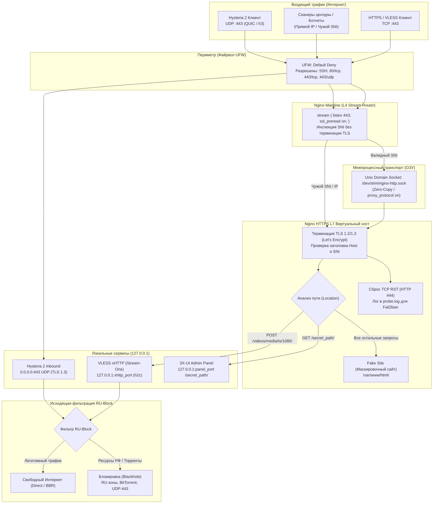

<p align="center">
  
</p>

<p align="center">
  <a href="https://ubuntu.com/"></a>
  <a href="https://nginx.org/"></a>
  <a href="https://github.com/XTLS/Xray-core"></a>
  <a href="https://github.com/MHSanaei/3x-ui"></a>
  
  
  
  
</p>

<p align="center">
  <strong>Автоматизированный комплекс развертывания и защиты серверной инфраструктуры обхода интернет-цензуры.</strong><br>
  Единый порт 443 (TCP + UDP), L4 Stream SNI-маршрутизация, оперативная память /dev/shm, изоляция на 127.0.0.1, RU-Block и BBR.
</p>

---

<p align="center">
  
</p>

---

## 📑 Содержание

- [1. Быстрый старт (Установка)](#1-быстрый-старт-установка)
  - [1.1 Однострочная команда запуска](#11-однострочная-команда-запуска)
  - [1.2 Интерактивный режим](#12-интерактивный-режим)
  - [1.3 Автоматический режим (CLI флаги)](#13-автоматический-режим-cli-флаги)
  - [1.4 Справочник аргументов командной строки](#14-справочник-аргументов-командной-строки)
- [2. Архитектура и сетевая схема](#2-архитектура-и-сетевая-схема)
  - [2.1 Принципы эшелонированной защиты](#21-принципы-эшелонированной-защиты)
  - [2.2 Визуальная схема прохождения пакетов (L4/L7)](#22-визуальная-схема-прохождения-пакетов-l4l7)
  - [2.3 Матрица сетевых сокетов и портов](#23-матрица-сетевых-сокетов-и-портов)
- [3. Стек протоколов и инбаунды](#3-стек-протоколов-и-инбаунды)
  - [3.1 VLESS + xHTTP (Stream-One)](#31-vless--xhttp-stream-one)
  - [3.2 Hysteria 2 (QUIC / UDP)](#32-hysteria-2-quic--udp)
  - [3.3 Готовые клиентские ссылки (URI)](#33-готовые-клиентские-ссылки-uri)
- [4. Эшелонированная безопасность и Hardening](#4-эшелонированная-безопасность-и-hardening)
  - [4.1 Изоляция панели на 127.0.0.1](#41-изоляция-панели-на-127001)
  - [4.2 Модуль RU-Block (Outbound Filter)](#42-модуль-ru-block-outbound-filter)
  - [4.3 Защита и перенос SSH (SSH Hardening)](#43-защита-и-перенос-ssh-ssh-hardening)
  - [4.4 Защита от брутфорса и зондирования (Fail2ban)](#44-защита-от-брутфорса-и-зондирования-fail2ban)
  - [4.5 Маскировочный сайт (Fake Site) и сброс 444](#45-маскировочный-сайт-fake-site-и-сброс-444)
  - [4.6 Автоматические обновления безопасности](#46-автоматические-обновления-безопасности)
- [5. Оптимизация ядра Linux (Sysctl & Performance)](#5-оптимизация-ядра-linux-sysctl--performance)
- [6. Системные требования](#6-системные-требования)
- [7. Распределенная топология (Master / Node)](#7-распределенная-топология-master--node)
- [8. Контейнеризированное тестирование в Docker](#8-контейнеризированное-тестирование-в-docker)
  - [8.1 Автоматизированный регрессионный сьют (51 тест)](#81-автоматизированный-регрессионный-сьют-51-тест)
  - [8.2 Интерактивная веб-песочница в браузере](#82-интерактивная-веб-песочница-в-браузере)
- [9. Эксплуатация, администрирование и бэкапы](#9-эксплуатация-администрирование-и-бэкапы)
- [10. Полное удаление комплекса](#10-полное-удаление-комплекса)
- [11. Мультиагентный регламент разработки](#11-мультиагентный-регламент-разработки)

---

## 1. Быстрый старт (Установка)

> [!IMPORTANT]
> Скрипт выполняется от пользователя **root** на чистой операционной системе (Ubuntu 22.04 / 24.04 или Debian 12). Перед установкой убедитесь, что DNS A-запись домена указывает на IP вашего сервера.

### 1.1 Однострочная команда запуска

Для автоматической загрузки и запуска мастера развертывания выполните:

```bash
bash -c "$(curl -fsSL https://raw.githubusercontent.com/your-org/vpn_script/main/script.sh)"
```

Или клонируйте репозиторий:

```bash
git clone https://github.com/your-org/vpn_script.git
cd vpn_script
chmod +x script.sh
sudo ./script.sh
```

---

### 1.2 Интерактивный режим

При запуске без дополнительных параметров мастер проведет вас по ключевым шагам:
1. **Проверка окружения:** Установка недостающих пакетов, Nginx Mainline и актуального ядра Xray-core.
2. **Ввод домена:** Запрос поддомена (например, `vpn.example.com`). Скрипт выполнит DNS preflight-проверку A-записи.
3. **SSH Hardening:** Запрос нового порта для OpenSSH (по умолчанию `60022`):
   ```text
   Enter SSH port to harden server [default: 60022, press Enter for 60022, or 22 to keep]:
   ```
4. **SSL Let's Encrypt:** Выпуск сертификата через Certbot и установка деплой-хука ротации.
5. **Генерация инбаундов:** Автоматическое конфигурирование базы SQLite (`VLESS + xHTTP` и `Hysteria 2`).
6. **Финальная сводка:** Вывод учетных данных панели и прямых клиентских ссылок.

---

### 1.3 Автоматический режим (CLI флаги)

Идеально подходит для Cloud-Init, Ansible и скриптов автоматизации хостинга:

```bash
sudo ./script.sh \
  -install y \
  -subdomain "vpn.example.com" \
  -ssh_port 60022 \
  -block_ru y \
  -mode master
```

---

### 1.4 Справочник аргументов командной строки

| Аргумент | Допустимые значения | По умолчанию | Назначение |
| :--- | :---: | :---: | :--- |
| `-subdomain` | `FQDN` строка | — | Доменное имя сервера для выпуска SSL-сертификата и SNI-маршрутизации |
| `-ssh_port` | `22` – `65535` | `22` *(или `60022`)* | Порт службы OpenSSH для защиты от сканеров и ботнетов |
| `-install` | `y` / `n` | `y` | Установка системных зависимостей, репозитория Nginx Mainline и утилит |
| `-block_ru` | `y` / `n` | `y` | Включение модуля фильтрации исходящего трафика на российские ресурсы |
| `-mode` | `master` / `node` | `master` | Роль сервера: мастер-панель управления или подчиненная нода |
| `-master_ip` | `IPv4-адрес` | — | IP-адрес мастер-сервера для предоставления доступа к ноде через UFW |
| `-auto_domain` | `y` / `n` | `n` | Использование автоматических доменов вида `<IP>.cdn-one.org` |
| `-uninstall` | `y` / `n` | `x` | Полная деинсталляция всех компонентов и очистка системы |

---

## 2. Архитектура и сетевая схема

### 2.1 Принципы эшелонированной защиты

Комплекс исключает выставление сервисов панели и инбаундов напрямую в интернет:

1. **Единый порт 443 (TCP + UDP):** 
   - `443/TCP` обслуживается Nginx Stream (`ssl_preread on`) без расшифровки трафика.
   - `443/UDP` напрямую слушает инбаунд **Hysteria 2** с нативным TLS 1.3 и ALPN `h3`.
2. **Нулевой сетевой оверхед (RAM Unix Socket):**
   - Nginx Stream пересылает проверенный по SNI трафик на локальный виртуальный хост через сокет в оперативной памяти `/dev/shm/nginx-http.sock` с флагом `proxy_protocol on;`, устраняя TCP-петли loopback-стека.
3. **Изоляция Localhost:**
   - Веб-панель 3X-UI и инбаунд VLESS xHTTP слушают исключительно `127.0.0.1`.
4. **Сброс зондов (HTTP 444):**
   - Запросы без корректного SNI или содержащие спецсимволы эксплойтов мгновенно разрываются TCP RST без ответа.

---

### 2.2 Визуальная схема прохождения пакетов (L4/L7)

<p align="center">
  
</p>



---

### 2.3 Матрица сетевых сокетов и портов

| Служба | Протокол | Локальный сокет | Публичный порт | Доступ извне | Назначение |
| :--- | :---: | :---: | :---: | :---: | :--- |
| **Nginx Stream** | TCP | `0.0.0.0:443`, `[::]:443` | `443` | Открыт | L4 маршрутизация по SNI на сокет в памяти |
| **Hysteria 2 (Xray)** | UDP | `0.0.0.0:443` | `443` | Открыт | Резервный скоростной QUIC-туннель |
| **Nginx HTTP/2 VHost** | UNIX | `unix:/dev/shm/nginx-http.sock` | — | Закрыт (ОЗУ) | Терминация TLS, маскировка, отдача Fake Site |
| **Nginx Anti-Loop** | TCP | `127.0.0.1:9443` | — | Локально | Предотвращение петель REALITY/Steal-Self |
| **Nginx ACME** | TCP | `0.0.0.0:80` | `80` | Открыт | Прохождение проверок Certbot и редирект на HTTPS |
| **3X-UI Web Admin** | TCP | `127.0.0.1:${panel_port}` | — | **Строго закрыт** | Доступ только через Nginx по секретному пути |
| **VLESS xHTTP Inbound** | TCP | `127.0.0.1:${xhttp_port}` | — | **Строго закрыт** | Cleartext h2c бэкенд для VLESS стриминга |
| **OpenSSH Daemon** | TCP | `0.0.0.0:${SSH_PORT}` | `60022` *(или `22`)* | Открыт | Удаленное администрирование с защитой Fail2ban |

---

## 3. Стек протоколов и инбаунды

### 3.1 VLESS + xHTTP (Stream-One)

**xHTTP** инкапсулирует трафик туннеля в стандартные потоки HTTP/2:
- **Путь:** `https://domain.tld/videos/media/ts/1080/`.
- **Метод:** HTTP/2 `POST` со стримингом бинарных данных (`application/octet-stream`).
- **Сквозное шифрование:** Встроенный механизм `vlessenc` генерирует индивидуальные ключи шифрования на уровне ядра Xray.
- **Обфускация заголовков:** Запросы маскируются под трафик CDN Amazon CloudFront (`X-Amz-Security-Token`, Base62 `x-amz-cf-id`, `X-Amz-Meta-Trace`) со случайным заполнением `xPaddingBytes` (128–1120 байт).
- **Оптимизация Nginx:** Директивы `proxy_buffering off;`, `proxy_socket_keepalive on;` и `proxy_http_version 2;` обеспечивают нулевые задержки.

---

### 3.2 Hysteria 2 (QUIC / UDP)

**Hysteria 2** обеспечивает максимальную скорость и стабильность в сетях с высоким процентом потерь пакетов:
- **Порт:** `443/UDP`.
- **Шифрование:** Нативный TLS 1.3 с боевым сертификатом Let's Encrypt и ALPN `h3`.
- **Маскировка (Masquerade):** Неавторизованные зонды перенаправляются на локальный сайт `http://127.0.0.1:80`.
- **Контроль перегрузки:** Алгоритм TCP BBR с расширенными буферами сокетов ядра (до 16 МБ).

---

### 3.3 Готовые клиентские ссылки (URI)

После развертывания скрипт генерирует готовые конфигурационные ссылки:

#### VLESS-xHTTP URI:
```text
vless://<UUID>@<DOMAIN>:443?type=xhttp&security=tls&encryption=none&flow=xtls-rprx-vision&path=%2Fvideos%2Fmedia%2Fts%2F1080%2F&mode=stream-one&sni=<DOMAIN>#🇷🇺%20<DOMAIN>%20(xHTTP)
```

#### Hysteria 2 URI:
```text
hysteria2://<UUID>@<DOMAIN>:443/?sni=<DOMAIN>&alpn=h3#🇷🇺%20<DOMAIN>%20(Hysteria2)
```

---

## 4. Эшелонированная безопасность и Hardening

### 4.1 Изоляция панели на 127.0.0.1
Параметр `webListen` в базе SQLite жестко зафиксирован на `127.0.0.1`. Вход в панель управления возможен только через обратный прокси Nginx по случайно сгенерированному секретному пути (например, `https://domain.tld/r8K2p9Lm4Q/`). Файл базы `/etc/x-ui/x-ui.db` защищен правами `chmod 600`.

---

### 4.2 Модуль RU-Block (Outbound Filter)
Для предотвращения деанонимизации пользователя при случайных обращениях к российским веб-ресурсам внедряется фильтр исходящего трафика:
- Автозагрузка актуальных баз `geosite_RU.dat` (Runetfreedom) и `geoip.dat` (Loyalsoldier).
- Направление трафика к доменам `ext:geosite_RU.dat:ru-blocked-all`, IP-адресам `geoip:ru`, приватным сетям `geoip:private` и протоколам `bittorrent` в аутбаунд `blackhole`.
- Блокировка исходящего UDP 443 для предотвращения падения скорости из-за нестабильного провайдерского QUIC.

---

### 4.3 Защита и перенос SSH (SSH Hardening)
- Безопасный перенос OpenSSH на кастомный порт (по умолчанию `60022/tcp`).
- Предварительное открытие порта в файрволе UFW до редактирования конфигурации.
- Валидация синтаксиса через `sshd -t` с автоматическим откатом при ошибках.
- Перезагрузка демона без разрыва текущих активных сессий администратора.

---

### 4.4 Защита от брутфорса и зондирования (Fail2ban)
1. **Джейл `[nginx-probe]`:** Анализирует `/var/log/nginx/probe.log`. При 5 подозрительных запросах (`400`, `401`, `403`, `404`, `429`, `444`) за 60 секунд IP блокируется файрволом на **24 часа**.
2. **Джейл `[sshd]`:** Защищает кастомный порт SSH. Блокирует IP на **24 часа** после 3 неудачных попыток входа за 10 минут.

---

### 4.5 Маскировочный сайт (Fake Site) и сброс 444
- В каталог `/var/www/html/` загружается правдоподобный маскировочный сайт. Прямые заходы в корень или по неизвестным путям отдают легитимный веб-ресурс.
- Запросы со спецсимволами эксплойтов (`../`, `//`, `0x00`, `$`, `~`) мгновенно сбрасываются с кодом `444` (TCP RST без передачи данных).

---

### 4.6 Автоматические обновления безопасности
Система настраивает `unattended-upgrades`: критические патчи ядра Linux и библиотек устанавливаются ежедневно в фоновом режиме без перезагрузки сервера.

---

## 5. Оптимизация ядра Linux (Sysctl & Performance)

В `/etc/sysctl.d/99-xui-tuning.conf` активируются параметры тюнинга высоконагруженного сетевого стека:

```ini
# BBR и справедливые очереди пакетов
net.core.default_qdisc = fq
net.ipv4.tcp_congestion_control = bbr

# TCP Fast Open: 0-RTT рукопожатия (клиент + сервер)
net.ipv4.tcp_fastopen = 3

# Расширение очередей сетевого стека
net.core.somaxconn = 65535
net.ipv4.tcp_max_syn_backlog = 65535
net.core.netdev_max_backlog = 16384

# Буферы сокетов TCP и UDP до 16 МБ (для Hysteria 2)
net.core.rmem_max = 16777216
net.core.wmem_max = 16777216
net.ipv4.tcp_rmem = 4096 87380 16777216
net.ipv4.tcp_wmem = 4096 65536 16777216
net.ipv4.udp_mem = 65536 131072 262144

# Защита от bufferbloat и задержек стримов xHTTP
net.ipv4.tcp_notsent_lowat = 16384
net.ipv4.tcp_tw_reuse = 1
net.ipv4.ip_forward = 1
```

Для сервисов `nginx.service` и `x-ui.service` на уровне systemd подключаются оверрайды:
```ini
[Service]
LimitNOFILE=65535
```

---

## 6. Системные требования

- **ОС:** Ubuntu 22.04 LTS *(Рекомендуется)*, Ubuntu 24.04 LTS, Ubuntu 20.04 LTS, Debian 12.
- **CPU:** 1 vCPU (x86_64, amd64, arm64).
- **RAM:** от 512 МБ (рекомендуется от 1 ГБ).
- **Диск:** от 5 ГБ свободного пространства.
- **Сеть:** Статический белый IPv4-адрес, направленная DNS A-запись домена, открытые порты `80/tcp`, `443/tcp`, `443/udp` и SSH-порт.

---

## 7. Распределенная топология (Master / Node)

Комплекс поддерживает горизонтальное масштабирование инфраструктуры:

1. **Мастер-сервер (Центральная панель):**
   ```bash
   sudo ./script.sh -install y -subdomain "master.example.com" -mode master
   ```
2. **Периферийная нода (Worker Node):**
   ```bash
   sudo ./script.sh -install y -subdomain "node1.example.com" -mode node -master_ip "IP_МАСТЕРА"
   ```
   *В режиме `node` настраивается локальный Nginx Stream, выпускается сертификат Let's Encrypt, а файрвол UFW открывает доступ к локальному порту панели исключительно для IP-адреса Мастера.*

---

## 8. Контейнеризированное тестирование в Docker

> [!CAUTION]
> **Инвариант безопасности:** Тестирование скрипта на хостовой ОС строго запрещено. Любая верификация производится **исключительно внутри Docker-контейнеров**.

### 8.1 Автоматизированный регрессионный сьют (51 тест)

Сьют [`test_script.sh`](file:///home/kex1tu/Рабочий%20стол/vpn_script/test_script.sh) проверяет:
- Синтаксис Bash (`bash -n`) и корректность конфигов Nginx (`nginx -t`);
- Идемпотентность повторного развертывания;
- Структуру базы данных SQLite и инъекцию правил RU-Block;
- Валидацию синтаксиса `sshd -t`, джейлов Fail2ban, оверрайдов sysctl и ссылок.

```bash
# Сборка тестового контейнера
docker build -f Dockerfile.test -t xui-test .

# Запуск полного сьюта тестов
docker run --rm xui-test
```

---

### 8.2 Интерактивная веб-песочница в браузере

Позволяет запустить рабочую связку 3X-UI и Nginx локально на вашей машине с пробросом портов в браузер:

```bash
./run_interactive.sh
```

Панель станет доступна в браузере хоста:  
👉 **`https://localhost:8443/panel/`** *(Логин: `admin` / Пароль: `admin`)*

---

## 9. Эксплуатация, администрирование и бэкапы

### Управление через встроенный CLI

```bash
# Просмотр статуса сервисов
x-ui status

# Перезапуск, остановка и запуск
x-ui restart
x-ui stop
x-ui start

# Просмотр системных журналов
x-ui log

# Просмотр списка IP-адресов, заблокированных Fail2ban
x-ui banlog

# Смена логина и пароля администратора через консоль
/usr/local/x-ui/x-ui setting -username "admin_new" -password "secure_pass" -port "2096"
systemctl restart x-ui
```

### Резервное копирование и восстановление

```bash
# Ручной бэкап базы данных
cp /etc/x-ui/x-ui.db /etc/x-ui/x-ui.db.bak_$(date +%s)

# Откат из автоматического бэкапа RU-Block
cp /etc/x-ui/x-ui.db.backup_ru /etc/x-ui/x-ui.db && systemctl restart x-ui

# Проверка целостности базы данных
sqlite3 /etc/x-ui/x-ui.db "PRAGMA integrity_check;"
```

---

## 10. Полное удаление комплекса

Для бесследной очистки сервера от всех компонентов, баз данных, сертификатов и настроек файрвола:

```bash
sudo ./script.sh -uninstall y
```

Скрипт остановит службы, удалит файлы конфигураций, восстановит дефолтный порт SSH `22`, очистит оверрайды sysctl и удалит установленные пакеты через `apt purge`.

---

## 11. Мультиагентный регламент разработки

Разработка и сопровождение кодовой базы подчиняются спецификации [**`AGENTS.md`**](file:///home/kex1tu/Рабочий%20стол/vpn_script/AGENTS.md):
- **`orchestrator-agent`** — архитектурное планирование и декомпозиция задач;
- **`devops-architect-agent`** — разработка bash-сценариев и конфигураций Nginx/Xray с комментариями «Why, not What»;
- **`docker-qa-agent`** — тестирование строго в Docker-песочнице;
- **`security-compliance-agent`** — аудит сетевой изоляции портов и прав доступа.

Любые PR и коммиты принимаются только при сохранении 100% успешности тестового сьюта (`51 of 51 PASS`).
